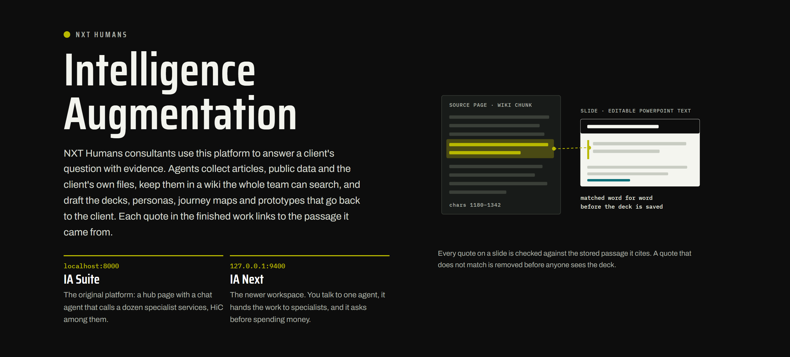
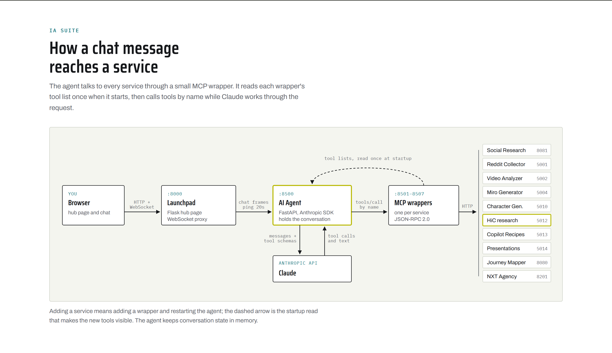
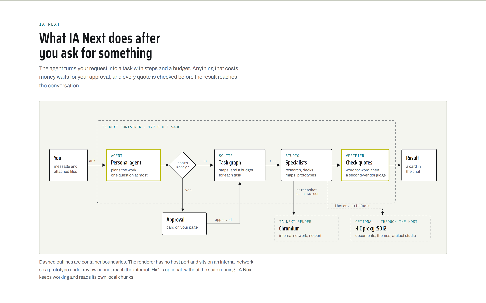
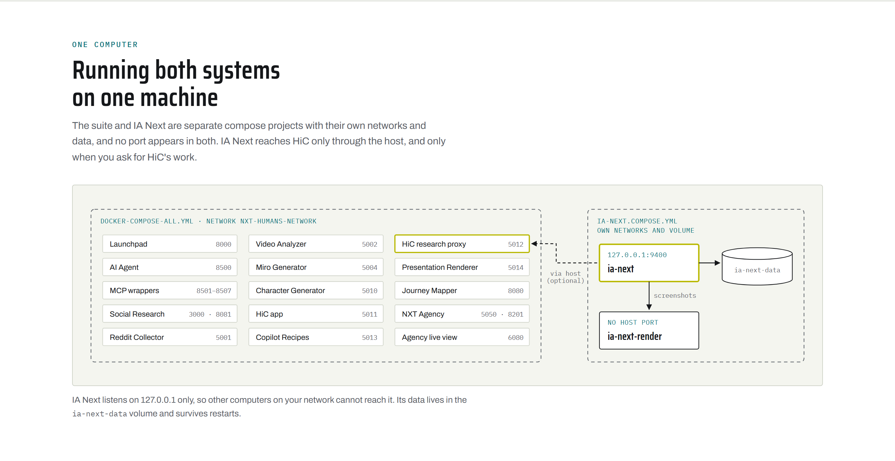

# NXT Intelligence Augmentation

<p align="center">
  <a href="https://nxtlupo.github.io/internal-solution-selfimprovement-IA-HiC/"></a>
</p>

NXT Humans consultants use this platform to answer a client's question with evidence. Agents collect articles, public data and the client's own files, store them in a wiki the team can search, and draft the decks, personas, journey maps and prototypes that go back to the client. Each quote in the finished work links to the passage it came from.

This repository holds two systems, and both can run on the same computer at once:

| | Open | What it is |
|---|---|---|
| **IA Suite** | http://localhost:8000 | The original platform. A hub page and a chat agent that calls a dozen specialist services through MCP, including HiC (Humans in Control), the research and deliverable engine. Guide: [`ia-suite-2026-11-17`](https://github.com/NXTLupo/internal-solution-selfimprovement-IA-HiC/tree/ia-suite-2026-11-17) |
| **IA Next** | http://127.0.0.1:9400 | The newer workspace. You talk to one agent; it hands the work to specialists, asks before anything costs money, and checks quotes against their sources. Guide: [`ia-next-2026-11-17`](https://github.com/NXTLupo/internal-solution-selfimprovement-IA-HiC/tree/ia-next-2026-11-17) |

**[Open the illustrated overview](https://nxtlupo.github.io/internal-solution-selfimprovement-IA-HiC/)** (also available as a [Claude artifact](https://claude.ai/artifact/8AwEYEAiaUBnDvzKgBSpmd?sk=J8929BM-meO7ZBlz5J-byA)).

## How the parts work

<picture>
  <source media="(prefers-color-scheme: dark)" srcset="docs/readme/overview-suite-dark.png">
  
</picture>

<picture>
  <source media="(prefers-color-scheme: dark)" srcset="docs/readme/overview-hic-dark.png">
  
</picture>

<picture>
  <source media="(prefers-color-scheme: dark)" srcset="docs/readme/overview-ianext-dark.png">
  
</picture>

<picture>
  <source media="(prefers-color-scheme: dark)" srcset="docs/readme/overview-together-dark.png">
  
</picture>

---

# IA Next

IA Next is the newer of the two systems. You open one page and describe what you need in plain words. The agent plans the work and hands it to specialists for research, analysis, writing, decks, journey maps, prototypes, social listening, images and video. It checks every quote against its source, asks for your approval before anything costly, and brings the finished work back into the same conversation.

It runs as **two containers on one port (9400)**: the workspace, and a renderer with no port of its own that screenshots prototypes for their design review. It has its own compose project, networks and data, separate from the original suite. When the suite is running, IA Next can also use HiC's engine through the host (documents, data packs, the second brain, themes and HiC's artifact studio); without it, IA Next still works on its own.

> **You are on the `ia-next-2026-11-17` branch.** The original suite (Launchpad, HiC, Social Research, Journey > Mapper and the rest) has its own guide on the [`ia-suite-2026-11-17`](https://github.com/NXTLupo/internal-solution-selfimprovement-IA-HiC/tree/ia-suite-2026-11-17) branch. > The suite's code is also in this branch, with the same HiC fixes, so you can run it from here too.

---

## Contents

1. [At a glance](#at-a-glance)
2. [Which branch should I use?](#which-branch-should-i-use)
3. [What you need before you start](#what-you-need-before-you-start)
4. [Start IA Next, step by step](#start-ia-next-step-by-step)
5. [Ports and addresses](#ports-and-addresses)
6. [Running IA Next and the original suite side by side](#running-ia-next-and-the-original-suite-side-by-side)
7. [Using HiC's engine](#using-hics-engine)
8. [Using IA Next](#using-ia-next)
9. [Brands: NXT Humans and Northeastern](#brands-nxt-humans-and-northeastern)
10. [Approvals and cost](#approvals-and-cost)
11. [Everyday operations](#everyday-operations)
12. [Troubleshooting](#troubleshooting)
13. [How it works](#how-it-works)
14. [Where the code lives](#where-the-code-lives)
15. [Security](#security)
16. [Further reading](#further-reading)

---

## At a glance

| | |
|---|---|
| **Open it at** | **http://127.0.0.1:9400** (also http://localhost:9400) |
| **Start** | `docker compose -f ia-next/ia-next.compose.yml up -d --build` |
| **Stop** | `docker compose -f ia-next/ia-next.compose.yml down` (your work is kept) |
| **Health check** | http://127.0.0.1:9400/health |
| **Containers** | `ia-next` (image `ia-next:0.1`, the workspace) and `ia-next-render` (image `ia-next-render:0.1`, Chromium for the prototype design review; no host port) |
| **Your data** | Docker volume `ia-next-data` (engagements, files, memory, task history) |
| **Keys** | Read from the repository's root `.env` (the same file the suite uses) |
| **Reachable from other computers?** | No. It listens on 127.0.0.1 only, your own machine. |

---

## Which branch should I use?

| Branch | What it is for | Main address | Guide |
|---|---|---|---|
| **`ia-next-2026-11-17`** (this one) | IA Next, the personal agent and its studio | http://127.0.0.1:9400 | This README |
| `ia-suite-2026-11-17` | The original Intelligence Augmentation suite: Launchpad hub, Humans in Control (HiC), Social Research, Journey Mapper, the cowork agent and the other apps (24 containers) | http://localhost:8000 and http://localhost:5011 | That branch's README |

Both branches were cut from the same commit on 17 November 2026, so each one contains all of the code. The
difference is which system the branch is developed and documented for. Never merge either branch into `main`.

---

## What you need before you start

You need **Docker Desktop** and **Git**. Python, every library and the PowerPoint tooling are installed inside
the IA Next container; you do not install them on your computer.

| Requirement | macOS | Windows |
|---|---|---|
| Docker Desktop (includes `docker compose`) | [Download](https://www.docker.com/products/docker-desktop/) | [Download](https://www.docker.com/products/docker-desktop/), with the WSL 2 backend turned on |
| Git | Preinstalled, or `brew install git` | [Git for Windows](https://git-scm.com/download/win) (installs Git Bash) |
| Where to type commands | Terminal | **Git Bash** (recommended) or PowerShell |
| Memory for Docker | 2 GB is enough for IA Next alone; 16 GB if you also run the full suite | Same |
| Disk | About 2 GB for IA Next | Same |

Check Docker is running:

```bash
docker --version
docker compose version     # note the space: "docker compose", not "docker-compose"
docker info                # must succeed; if it fails, open Docker Desktop and wait
```

### API keys

IA Next uses three AI providers. Put the keys in a file named `.env` in the **root of the repository** (the
folder that contains `docker-compose-all.yml`). If you already run the suite, this file exists and IA Next uses
it as it is.

| Key | Needed for | Required? |
|---|---|---|
| `ANTHROPIC_API_KEY` | The agent itself, writing, analysis, decks, journey maps, prototypes | **Yes** |
| `OPENAI_API_KEY` | Images, audio transcription, and the reviewer from a second vendor | **Yes** |
| `GEMINI_API_KEY` (or `GOOGLE_API_KEY`) | Web research with Google Search, video | **Yes** |
| `REDDIT_CLIENT_ID`, `REDDIT_CLIENT_SECRET`, `REDDIT_USER_AGENT` | Reddit listening | Only for Reddit |
| `IA_NEXT_TASK_SPEND_APPROVAL_USD` | The spend level above which a task waits for your approval (default `3.00`) | No |
| `IA_NEXT_CHANNEL_SECRET` | The signed webhook for Slack, Teams or email bridges (off until set) | No |
| `MICROSOFT_APP_ID`, `MICROSOFT_APP_PASSWORD`, `TEAMS_TENANT_ID` | The Microsoft Teams channel (off until set) | No |

Example `.env` (use your own values; never commit this file, it is already in `.gitignore`):

```env
ANTHROPIC_API_KEY=sk-ant-...
OPENAI_API_KEY=sk-...
GEMINI_API_KEY=...
```

---

## Start IA Next, step by step

### 1. Get the code

```bash
git clone https://github.com/NXTLupo/internal-solution-selfimprovement-IA-HiC.git
cd internal-solution-selfimprovement-IA-HiC
git checkout ia-next-2026-11-17
```

### 2. Create the `.env` file

Create `.env` in the repository root with the three required keys (see the table above).

- macOS or Git Bash: `nano .env`, paste, then Ctrl-O, Enter, Ctrl-X.
- Windows: `notepad .env`, paste, save. If Notepad adds `.txt`, rename the file to `.env`.

### 3. Build and start IA Next

From the repository root:

```bash
docker compose -f ia-next/ia-next.compose.yml up -d --build
```

This starts two containers: `ia-next` (the workspace) and `ia-next-render` (Chromium, used only to screenshot
prototypes for their design review). The first build takes five to ten minutes, most of it downloading Chromium for
the renderer. Later starts take seconds.

### 4. Check it is healthy

```bash
docker compose -f ia-next/ia-next.compose.yml ps        # both containers should say "healthy"
curl http://127.0.0.1:9400/health
```

You should see something like:

```json
{"status":"healthy","service":"ia-next","version":"0.1.0","port":9400,
 "provider_keys_present":{"anthropic":true,"google":true,"openai":true}}
```

All three `provider_keys_present` values must be `true`. If one is `false`, that key is missing from `.env`:
add it and run step 3 again.

PowerShell users can run `Invoke-RestMethod http://127.0.0.1:9400/health` instead of `curl`.

### 5. Open it

Go to **http://127.0.0.1:9400** in your browser. The home page shows the studio's specialists, example requests,
what changed since you last looked, anything waiting for your approval, and your recent work.

---

## Ports and addresses

IA Next publishes **exactly one port**. Its second container, the renderer, publishes none.

| What | Address | Notes |
|---|---|---|
| **IA Next workspace (the page)** | **http://127.0.0.1:9400** | Bound to 127.0.0.1, so only your own computer can reach it |
| Health check | http://127.0.0.1:9400/health | Returns JSON; used by Docker's health check every 30 seconds |
| API | http://127.0.0.1:9400/api/... | The page's own API (tasks, engagements, approvals, spend, digest) |

Inside Docker the workspace container also listens on 9400, on its own private network `ia-next-net`. It is not on
the suite's network. It reaches HiC only through the host (`host.docker.internal:5012`, HiC's proxy), for the
capabilities described in [Using HiC's engine](#using-hics-engine).

| Container | Host port | Networks | Why |
|---|---|---|---|
| `ia-next` | 9400 on 127.0.0.1 | `ia-next-net`, `ia-next-render` | The workspace, the agent and the studio |
| `ia-next-render` | none | `ia-next-render` only (internal: no route to the internet) | Opens each prototype in Chromium and screenshots every screen for the design review. Prototypes are model-written code, so they run here, with no API keys, no data volume and no internet, never inside `ia-next` |

**Changing the port.** If something else on your computer already uses 9400, start IA Next on another host port:

```bash
IA_NEXT_PORT=9410 docker compose -f ia-next/ia-next.compose.yml up -d     # then open http://127.0.0.1:9410
```

(PowerShell: `$env:IA_NEXT_PORT=9410; docker compose -f ia-next/ia-next.compose.yml up -d`.) Pick a port outside
the suite's list below.

---

## Running IA Next and the original suite side by side

The two systems share the API keys in the root `.env`, and IA Next can call HiC's proxy through the host (see
[Using HiC's engine](#using-hics-engine)). You can start, stop and rebuild either one without touching the other;
IA Next works on its own when the suite is off.

| | Original suite | IA Next |
|---|---|---|
| Compose file | `docker-compose-all.yml` | `ia-next/ia-next.compose.yml` |
| Compose project name | `nxt-humans_ai_cx_workbench` | `ia-next` |
| Docker networks | `nxt-humans-network` | `ia-next-net`, and `ia-next-render` (internal) |
| Containers | 24 | 2 (`ia-next`, `ia-next-render`) |
| Data | the suite's volumes and `humans-in-control-research/hic-workspace/` | the `ia-next-data` volume |
| Host ports | 3000, 5001, 5002, 5004, 5010, 5011, 5012, 5013, 5014, 5015, 5050, 6080, 8000, 8080, 8081, 8201, 8500, 8501, 8502, 8503, 8504, 8507, 8508 | **9400** only |
| Calls into the other system | none | HiC's proxy through the host, optional (documents, data packs, the second brain, themes, the artifact studio) |

**Port check, 17 November 2026 (evening).** With all 24 suite containers and both IA Next containers running
together (27 containers in all), every published port was listed with `docker ps`: 25 host ports, each used by one
container; IA Next's 9400 is the only IA Next port and is not in the suite's list; the renderer publishes none. The
compose files agree: `docker-compose-all.yml` and `ia-next/ia-next.compose.yml` declare no host port in common. (On
the owner's workstation one more container, a SearXNG search service from a different project, uses
127.0.0.1:8890; it belongs to neither system and does not collide with either.)

To run both:

```bash
docker compose -f docker-compose-all.yml up -d --build          # the suite (first build 15 to 30 minutes)
docker compose -f ia-next/ia-next.compose.yml up -d --build     # IA Next
```

To check for a clash yourself at any time (Git Bash, macOS or Linux):

```bash
docker ps --format '{{.Ports}}' | tr ',' '\n' | grep -o '[0-9.]*:[0-9]*->' | sort | uniq -d
```

No output means no host port is published twice.

The only shared thing is brand design: IA Next keeps a **read-only copy** of HiC's design-system tokens
(`ia-next/ia_next/brand_tokens.json`), refreshed by a script, so its decks match HiC's brands without IA Next
ever calling the suite. See [Brands](#brands-nxt-humans-and-northeastern).

---

## Using HiC's engine

IA Next can use capabilities HiC already has, by calling HiC's research proxy through the host. This was the
owner's choice on 17 November 2026: the two systems keep separate networks, data and ports, and IA Next sends the
token HiC publishes in `humans-in-control-research/hic-workspace/.runtime/config.json`, which is mounted read-only
into the IA Next container. The token is re-read on every call, because HiC makes a new one each time its proxy
starts, and it is never logged or shown.

| Capability | What it does in IA Next | Needs the suite running? |
|---|---|---|
| Reading documents and images | PDF (scanned ones too), Word, PowerPoint, Excel, JSON, XML and images dropped into the chat are read by HiC and become sources | Yes; without it the upload says so, and text, subtitle, CSV and audio files still work |
| Data packs | Name a pack or an industry ("using the healthcare data pack"): research searches that pack's publications in HiC (17 packs, from Advancement & Fundraising to Insurance) before the open web, and adds up to six of the most relevant, dated items as named sources | Yes; without it the run notes that the packs were skipped and searches the web |
| The second brain | Every upload, and every source a deck or journey map is built from, is archived in HiC's wiki (`/api/wiki/write-article`), where HiC chunks it, records it in the manifest and embeds it. Builders read the evidence back as manifest chunk pointers (`page#c3`), so a document is read whole when it fits, not cut off at its first few thousand characters, and each deck records the pointers it used (`deck.json`, `evidence`) | Yes; without it the source is cut into local chunks of the same size, so coverage stays whole, and the deck records that the local path served it |
| Recall | When the agent recalls earlier work, it also searches the whole second brain (`/api/manifest/chunks-by-goal`): passages from every pack, upload and engagement HiC holds, ranked against your question, each with its chunk pointer | No; without it recall uses memory and IA Next's own evidence index |
| Themes | "#themes": HiC's topic model (`/api/topic-model/analyze`: UMAP with a fixed seed, HDBSCAN, a coherence gate) clusters the engagement's manifest chunks; the Theme Analyst names each cluster and quotes one passage, checked against that passage; saved as work with a branded page | Yes |
| Artifact studio | "#prd", "#roadmap", "#recs" and 16 more kinds: the corpus (findings plus manifest chunks of the named sources) goes to HiC's job store (`/api/jobs`, op `/api/artifact/generate`) and IA Next polls it; IA Next then checks every quoted passage against the sources and has a reviewer from another vendor score it. HiC meters its own model calls, so the card shows an estimate (1.50 USD) marked as one | Yes; decks, journey maps and prototypes still work without it |

When the suite is not running, IA Next says so in plain words and carries on with what it can do on its own.

### Attached files are what the work is built from

Files you attach in a conversation are listed with every message you send (the thread shows "Attached to
<engagement>: file names"). When you ask for work from them ("using the attached documents"), the deck, journey map
or prototype is built from those files alone, even if the engagement holds other material. The agent cannot start
such work while ignoring files attached with your message: it must name them, or say you asked for the whole
engagement. Files nobody has analysed yet are analysed first, as a visible step on the work's card.

## Using IA Next

### The page

- **Left rail.** *New conversation*; your **Engagements** (one per piece of client work; click one to focus the
  conversation and your uploads on it); **All work** (every finished output as a card); **Memory** (what the agent
  remembers about you, which you can read and remove; a removed fact stays removed, and people who reach the agent
  through a channel have memory of their own); **Schedules**; **Spend**.
- **Conversation.** Your messages and the agent's replies. When the agent starts work, a live card shows each
  specialist's step and the money spent so far. Finished work appears inline: a report you can read, a deck
  preview with a PowerPoint download, a journey map, a prototype you can click through.
- **Message box** (pinned at the bottom). Type, drop files, or dictate where your browser supports it. Enter
  sends; Shift and Enter makes a new line.
- **Top bar.** The engagement in focus, the system's status, what this conversation has cost (its answers and the
  work it started), and today's spend for the whole studio.
- **Conversations** (in the rail) lists past conversations; click one to reopen it. Conversations are kept on the
  server, so the agent picks up a reopened conversation even after IA Next restarts.

### Things to ask for

You do not need special syntax; describe what you want. Hashtags are a shortcut the agent also understands.

| You want | Try |
|---|---|
| A researched report | "Research how US universities are improving first-year retention in 2026, for a provost." |
| A deck | "#slides for the provost from this engagement: problem, evidence, options, recommendation, next steps." |
| To change one slide | "On that deck, make slide 4's title shorter" (only that slide changes; the others stay exactly as they are) |
| A deck in Northeastern branding | "Make a short deck for the Annual Giving team using Northeastern branding." (or `#nu`) |
| A journey map | "Map the journey of a first-year student who is thinking about leaving." |
| A clickable prototype | "#proto a dashboard where gift officers see which alumni cohorts to contact next." A product with several screens comes back as ONE connected prototype; add "in Northeastern branding" for the Northeastern brand. |
| Reddit listening | "What are people on r/college saying about academic advising this year?" (needs Reddit keys) |
| Analysis of your files | Drop interview transcripts, notes, CSV or text files, then: "What do these interviews say about donor follow-up?" |
| A mind map | "#mindmap of the findings in this engagement." (drawn as a diagram in the reply) |
| The themes in your material | "What are the themes in the attached documents? #themes" (HiC's topic model finds the clusters; each theme gets a quote checked against its passage) |
| A document from HiC's artifact studio | "#prd for the Farmers demo from these documents, Northeastern branding." Also #roadmap, #recs, #strategy, #brief, #blueprint, #personas, #competitive, #gap, #arch, #org, #audit, #case-study, #report, #whitepaper, #explainer, a heuristic UX review and a research plan. Quoted passages are checked against the sources and a reviewer from another vendor scores it; open it on its card or download the HTML |
| An image or a short video | "Make a cover image for this deck." / "Make a five second opening clip." (video always asks for approval) |
| To find past work | "Show my recent work" or "Open the latest report." |

Each request runs as a background task. You can keep talking while it works; the card updates by itself, and a
notice appears when it finishes.

### What every output guarantees

- Every quote is checked word for word against the source it cites; a quote that is not there is removed.
- Every citation points at a real source you can open.
- Reports are reviewed by a judge from a different AI vendor than the writer.
- Decks are native, editable PowerPoint files (real text, real shapes, sources in the speaker notes), never
  pictures of slides, and each download is named after the deck.
- Prototypes start from a creative direction (concept, screens, sample data, visual language, chosen from HiC's
  catalog of 92 AI experience patterns) and are built by an expert product-design skill in the brand. The renderer
  then opens the prototype and screenshots every screen; a designer model from another vendor reviews the screens as
  drawn as well as the code, a screen the navigation cannot reach becomes a required fix, and the prototype is
  revised once. The screenshots are kept with the work. Prototypes run sandboxed with no network access.
- Documents from HiC's artifact studio run in the same sandbox as prototypes (a sandboxed frame and a strict content
  policy), because they are model-written pages.
- Work you ask for from attached files is built from those files alone, read whole through the second brain.

### Engagements you do not need to see

Engagements made by automated checks are hidden from the list, never deleted. "Show N hidden engagements" at the
bottom of the list brings them back; every engagement also has a **Hide** (or **Show**) control on hover. When files
you drop land in an engagement that is about something else, the "Attached to ..." line in the conversation offers
**Use a new engagement for these files**: the files are copied into an engagement of their own and the
conversation follows them.

### Expert skills for every creator

Each creator (the Writer, Deck Composer, Creative Director, Prototyper, Journey Cartographer, Social Analyst,
Transcript Analyst and Theme Analyst) works from a governed skill: versioned instructions that change only when a
candidate passes a lint, then a held-out evaluation (past work replayed under the current and the candidate
instructions, scored by the same checks and a judge from another vendor; it spends, so it asks for approval), and
then your promotion. `GET /api/skills` lists them; every version is kept, so rolling back is promoting an earlier
one.

---

## Brands: NXT Humans and Northeastern

Decks, prototypes, journey maps and social analyses render in two brands, taken from HiC's design system (the Figma
library behind HiC):

| Brand | Colours | Typeface | Brand mark |
|---|---|---|---|
| **NXT Humans** (default) | Black rail, chartreuse accent, teal panels | Saira Condensed titles, Archivo text | The NXT HUMANS wordmark |
| **Northeastern** | Navy rail, Northeastern red accent, white text on red | Lato throughout | The red Northeastern N |

On decks the brand mark is drawn on the cover and in the corner of every slide as a native PowerPoint shape, so it
stays sharp and editable; prototypes, journey maps and social pages carry the same mark and colours.

- **Ask for it in words:** "Northeastern branding", "Northeastern colours", "NU" or `#nu` all select the
  Northeastern brand. Anything else is NXT Humans.
- **Change the brand of a deck you already have, at no cost:** press **Switch to Northeastern brand** (or
  **Switch to NXT Humans brand**) on the deck's card, or say "Put that deck in Northeastern branding". The same
  slides, words, images and sources are re-rendered with no new AI call. The card's detail line always names
  the brand in use.
- **When HiC's design system changes**, refresh IA Next's copy and rebuild:

  ```bash
  python ia-next/scripts/sync_brand_tokens.py
  docker compose -f ia-next/ia-next.compose.yml up -d --build
  ```

---

## Approvals and cost

- **Spend approval.** A task whose budget is above `IA_NEXT_TASK_SPEND_APPROVAL_USD` (default 3.00 USD) waits
  for you: an approval card appears in the conversation. Approve or deny it; a denied call is final. One approval
  covers one exact action, so the agent cannot reuse it for something else.
- **Send and delete.** Anything leaving the system (for example an email) and anything deleted also needs your
  approval.
- **Video** always needs approval, one approval per clip.
- **Seeing what you spend.** Today's spend is in the top bar; the **Spend** panel shows today, this week and
  spend by model. Every card shows its own cost. `GET /api/spend` also reports today's prompt caching (input read
  from the cache, input written to it) and what the agent's own turns cost.
- **Prompt caching.** The tools and system prompt are cached on every Claude call. The agent's tool loop also caches
  the conversation at its last block, so each step reads the earlier conversation at Claude Opus 5.5's cache price
  ($0.20 per million tokens instead of $4.00). One-off specialist calls do not cache their message, because a cache
  write costs 1.25 times the input price and would never be read back. The meter counts cache writes and reads at
  their real prices.
- A task stops when it reaches the budget you approved.
- **Asking before new research.** When an engagement already has findings, the agent builds decks, maps and other
  outputs from them, and asks you before paying for new web research.
- **A limit for one conversation.** A conversation may spend `IA_NEXT_SESSION_LIMIT_USD` (default 15.00 USD), its
  answers plus the work it started. Paid work that would take it past that waits for your approval card.
- **Research budget.** A research report uses the standard 3.00 USD budget unless you name another amount.

### Stop and Try again

- **Stop.** A running card has a **Stop** button (or say "stop that"). The server confirms at once and the card
  shows *Stopping*; the work ends after the step in flight and the card shows *Stopped* with what it spent.
  Whatever it had already written is kept.
- **Try again.** A card that did not finish (failed or stopped) has **Try again**. It starts the same request with
  the same budget. If that budget is above your approval level, an approval card appears first, because one approval
  covers one action. Pressing Try again twice starts one run, not two.

---

## Everyday operations

All commands run from the repository root.

```bash
# Status
docker compose -f ia-next/ia-next.compose.yml ps

# Follow the log
docker compose -f ia-next/ia-next.compose.yml logs -f

# Stop (your work is kept in the ia-next-data volume)
docker compose -f ia-next/ia-next.compose.yml down

# Start again
docker compose -f ia-next/ia-next.compose.yml up -d
```

### After changing IA Next's code

The code is built into the image, so rebuild after any change under `ia-next/`:

```bash
docker compose -f ia-next/ia-next.compose.yml up -d --build
```

**Do this only when nothing is running.** A restart marks any task still in progress as failed (it is never left
"running"; you can press Try again). To check:

```bash
curl -s http://127.0.0.1:9400/api/tasks | python -c "import json,sys; print([t['id'] for t in json.load(sys.stdin)['tasks'] if t['status'] not in ('done','failed')])"
```

An empty list `[]` means it is safe to rebuild.

### Run the tests

The tests are offline: no network and no AI calls. They run inside the image.

```bash
# macOS or Linux
docker run --rm -v "$PWD/ia-next/tests:/app/tests:ro" -v "$PWD/ia-next/ia_next:/app/ia_next:ro" \
  -v "$PWD/ia-next/web:/app/web:ro" -u root ia-next:0.1 python -m pytest -q -p no:cacheprovider tests

# Windows Git Bash (the two settings stop Git Bash rewriting the paths)
cd ia-next && MSYS_NO_PATHCONV=1 docker run --rm \
  -v "$(cygpath -w "$PWD/tests"):/app/tests:ro" -v "$(cygpath -w "$PWD/ia_next"):/app/ia_next:ro" \
  -v "$(cygpath -w "$PWD/web"):/app/web:ro" -u root ia-next:0.1 python -m pytest -q -p no:cacheprovider tests
```

On 17 November 2026: 223 tests, all passing.

### Benchmark a prototype against best-of-breed output

Put reference prototypes (single HTML files captured from v0, Figma Make, Claude artifacts or anything else) into
`/data/benchmarks/refs` inside the container, then run, with the task id of a finished prototype:

```bash
docker exec -i -e TASK=task_xxxxxxxxxxxx -e REFS=/data/benchmarks/refs -w /app ia-next python - < ia-next/scripts/benchmark_prototypes.py
```

Add `-e MAKE_CLAUDE_ARTIFACT=1` to also make one reference the way a Claude artifact is made (one pass from the same
brief). Every candidate is screenshotted by the renderer and scored by the same reviewer with the same rubric; the
table lands in `/data/benchmarks/<task>/report.md`. First run, 17 November 2026: IA Next's Northeastern Annual Giving
prototype scored 31 of 35 with all four screens reached; a one-pass reference from the same brief scored 12 and did
not finish its file.

### Back up and restore your data

```bash
# Back up the whole data volume to a dated archive in the current folder
docker run --rm -v ia-next-data:/data -v "$PWD":/backup ia-next:0.1 tar czf /backup/ia-next-data-backup.tgz -C /data .

# Restore it (stop IA Next first)
docker compose -f ia-next/ia-next.compose.yml down
docker run --rm -v ia-next-data:/data -v "$PWD":/backup ia-next:0.1 tar xzf /backup/ia-next-data-backup.tgz -C /data
docker compose -f ia-next/ia-next.compose.yml up -d
```

### Start completely fresh

```bash
docker compose -f ia-next/ia-next.compose.yml down -v     # DELETES every engagement, file, memory and task
```

---

## Troubleshooting

| What you see | What to do |
|---|---|
| The page does not open | Run `docker compose -f ia-next/ia-next.compose.yml ps`. If the container is not "healthy", read `... logs -f`. Make sure Docker Desktop is running. |
| "Port is already allocated" when starting | Something else uses 9400. Start on another port: `IA_NEXT_PORT=9410 docker compose -f ia-next/ia-next.compose.yml up -d`. |
| `provider_keys_present` shows `false` | That key is missing from the root `.env`. Add it, then run the start command again (the container reads `.env` when it starts). |
| A task failed after a restart | Restarts mark running tasks as failed. Press **Try again** on the card. |
| A deck came out in the wrong brand | Press the brand button on the deck's card, or say "Put that deck in Northeastern branding". It costs nothing. |
| A deck made before 17 November will not switch brand | Older decks did not keep their own copy of their sources. If the engagement's sources have changed since, IA Next refuses rather than write wrong source lines; ask for a new deck in the brand you want. |
| A research task is waiting | It is probably waiting for your approval: look for the approval card, or open **All work**. |
| Reddit listening fails | The Reddit keys are missing or wrong in `.env`. |
| The page looks out of date after an update | Rebuild (see above), then reload the page. |
| Running both systems is slow | The full suite needs about 16 GB for Docker. IA Next alone needs very little. |
| A document, themes or a PDF upload says HiC is not running | Those use HiC's engine: start the suite (`docker compose -f docker-compose-all.yml up -d`). Decks, journey maps, prototypes and text uploads work without it. |
| A prototype's card says its design review looked at the source only | The renderer is down: `docker compose -f ia-next/ia-next.compose.yml up -d ia-next-render`. The prototype is still built and checked. |
| A document from HiC waits | HiC's artifact studio costs about 3 USD per document by HiC's own meter, so it asks for your approval first. |
| Files went into the wrong engagement | On the "Attached to ..." line in the conversation, press **Use a new engagement for these files**. |
| An engagement you do not need is in the list | Hover it and press **Hide**. "Show hidden engagements" at the bottom brings it back; nothing is deleted. |

---

## How it works

```
Your browser ──► IA Next (one FastAPI app on 127.0.0.1:9400)
                   │
                   ├─ The agent (one conversation, a fixed set of tools)
                   │    asks at most one clarifying question, starts background tasks,
                   │    reports work as done only when the task store says so
                   │
                   ├─ The studio (specialists on a background task graph)
                   │    Brief Lead, Research Lead (Google Search grounding), Analyst,
                   │    Writer and Verifier, Journey Cartographer, Deck Studio,
                   │    Social Analyst, Transcript Analyst, Prototyper, Media Producer,
                   │    Theme Analyst and Artifact Studio (through HiC)
                   │    each working from a governed expert skill
                   │
                   ├─ Attention: work uses the files you attach or name (source ids)
                   ├─ Second brain: sources archived in HiC's wiki, read back as
                   │    manifest chunk pointers (local chunks when HiC is down)
                   │
                   ├──► ia-next-render (second container, internal network only):
                   │    Chromium screenshots each prototype screen for the design review
                   ├──► HiC's research proxy through the host (optional): documents,
                   │    data packs, the second brain, themes, the artifact studio
                   │
                   ├─ Controls: approvals for spend, send and delete; a budget per task
                   ├─ Verification: quotes checked verbatim, citations resolved,
                   │    a judge from a second vendor
                   ├─ Memory: what you have told it, behind a promotion gate you can inspect
                   └─ Storage: SQLite task graph and files in the ia-next-data volume
                   │
                   └──► AI providers (Anthropic, OpenAI, Google) using the keys in .env
```

Each piece of work is a **task** with **steps**. A step is running, then available with a result file, or failed;
a step that returns nothing counts as failed. Every output is stored under its own task, so a second report or deck
never replaces the first.

---

## Where the code lives

```
ia-next/
  ia-next.compose.yml     the one compose file for IA Next (port, networks, volume, the renderer)
  Dockerfile              the image: Python, python-pptx, the app and the page
  render/                 the second container: Chromium for prototype screenshots (no keys, no data, no internet)
  README.md               feature-by-feature status against the transformation plan
  ia_next/
    app.py                the web server: page, API routes, downloads, approvals
    agent.py              the agent: conversation, tool list, engagement focus, conversation spend limit
    attachments.py        files attached in a conversation: verified, stated to the agent, never left unnamed
    secondbrain.py        sources archived in HiC's wiki and read back as manifest chunks
    hic.py                the link to HiC's proxy (token read per call, never logged)
    artifacts.py          HiC's artifact studio (#prd, #roadmap, #recs and more), checked and sandboxed here
    themes.py             themes from HiC's topic model
    skills.py             governed expert skills, one per creator
    studio.py             research pipeline: Brief Lead, Research Lead, Analyst, Writer, Verifier
    deck.py, deckstudio.py   the Deck Studio: slides, native PowerPoint, brands, brand switch
    brand_tokens.json     read-only copy of HiC's brand tokens (colours, typefaces, logo vectors)
    fonts/                the brand typefaces (open licences), embedded in pages
    journey.py            the Journey Cartographer
    prototype.py          the Prototyper, its sandbox and its screenshot review
    social.py             Reddit listening
    transcripts.py        uploads and transcription
    media.py              images and video
    verify.py             verification rungs (quotes, citations, bans, judge)
    control.py            approvals
    memory.py, reviewer.py   memory and the background memory reviewer
    schedule.py           scheduled work
    channels.py, teams.py the signed webhook and the Teams channel
    library.py            the read-only research library (a copy of HiC's wiki)
    regression.py         per-application regression checks
    providers.py          calls to Anthropic, OpenAI and Google, metered
    store.py              the SQLite task store and the per-engagement file area
  web/                    the page: index.html, app.js, app.css, md.js, plain.js, vendor/ (Mermaid)
  scripts/                bake-offs, sync_brand_tokens.py, make_brand_fonts.py, benchmark_prototypes.py
  tests/                  the offline test suite
  regression/, bakeoffs/  recorded reports
```

---

## Security

- IA Next listens on **127.0.0.1 only**; other computers on your network cannot reach it.
- API keys live only in the root `.env`, which is git-ignored. Never paste keys into the page or commit them.
- Text from web pages and uploads is treated as data, never as instructions to the agent.
- Prototypes are model-written code: they run only inside a sandboxed frame (`allow-scripts`, no same-origin
  access) with a strict Content-Security-Policy.
- Anything that spends above the threshold, sends something out, or deletes something waits for your approval.

---

## Further reading

- [ia-next/README.md](ia-next/README.md): what runs today, section by section, with first live results.
- [docs/INTELLIGENCE_AUGMENTATION_TRANSFORMATION_PLAN.md](docs/INTELLIGENCE_AUGMENTATION_TRANSFORMATION_PLAN.md):
  the plan IA Next implements.
- The original suite's guide: the README on the
  [`ia-suite-2026-11-17`](https://github.com/NXTLupo/internal-solution-selfimprovement-IA-HiC/tree/ia-suite-2026-11-17)
  branch.

---

Proprietary software. All rights reserved.

*Branch `ia-next-2026-11-17` · IA Next 0.1 · NXT Humans*
