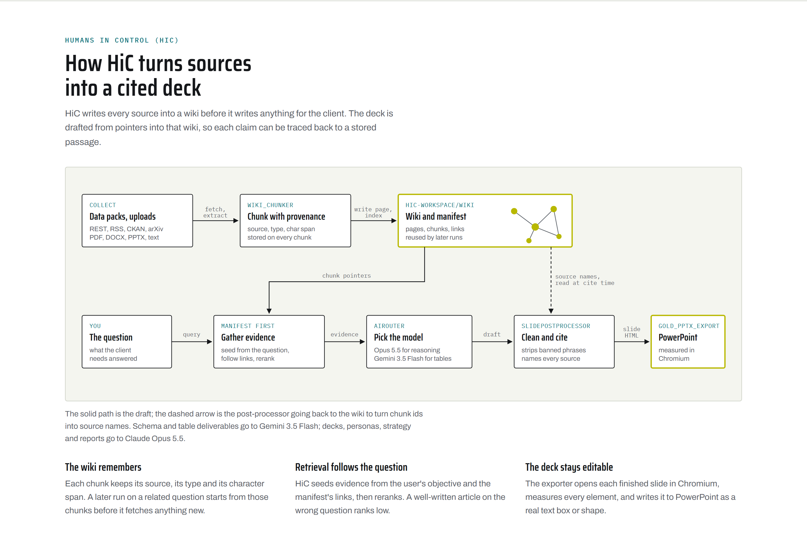

# NXT Intelligence Augmentation

<p align="center">
  <a href="https://nxtlupo.github.io/internal-solution-selfimprovement-IA-HiC/"></a>
</p>

NXT Humans consultants use this platform to answer a client's question with evidence. Agents collect articles, public data and the client's own files, store them in a wiki the team can search, and draft the decks, personas, journey maps and prototypes that go back to the client. Each quote in the finished work links to the passage it came from.

This repository holds two systems, and both can run on the same computer at once:

| | Open | What it is |
|---|---|---|
| **IA Suite** | http://localhost:8000 | The original platform. A hub page and a chat agent that calls a dozen specialist services through MCP, including HiC (Humans in Control), the research and deliverable engine. Guide: [`ia-suite-2026-11-17`](https://github.com/NXTLupo/internal-solution-selfimprovement-IA-HiC/tree/ia-suite-2026-11-17) |
| **IA Next** | http://127.0.0.1:9400 | The newer workspace. You talk to one agent; it hands the work to specialists, asks before anything costs money, and checks quotes against their sources. Guide: [`ia-next-2026-11-17`](https://github.com/NXTLupo/internal-solution-selfimprovement-IA-HiC/tree/ia-next-2026-11-17) |

**[Open the illustrated overview](https://nxtlupo.github.io/internal-solution-selfimprovement-IA-HiC/)** (also available as a [Claude artifact](https://claude.ai/artifact/8AwEYEAiaUBnDvzKgBSpmd?sk=J8929BM-meO7ZBlz5J-byA)).

## How the parts work

<picture>
  <source media="(prefers-color-scheme: dark)" srcset="docs/readme/overview-suite-dark.png">
  
</picture>

<picture>
  <source media="(prefers-color-scheme: dark)" srcset="docs/readme/overview-hic-dark.png">
  
</picture>

<picture>
  <source media="(prefers-color-scheme: dark)" srcset="docs/readme/overview-ianext-dark.png">
  
</picture>

<picture>
  <source media="(prefers-color-scheme: dark)" srcset="docs/readme/overview-together-dark.png">
  
</picture>

---

# The IA Suite

The suite is a set of research, content and customer-experience tools that run as Docker services, plus a cowork agent that can operate those tools for you in a browser you watch live. Its main surface is Humans in Control (HiC): you give it a brief and your files, and it produces strategy decks, personas, journey maps, service blueprints, PRDs and competitive analyses, using Gemini, Claude and OpenAI models.

> **You are on the `ia-suite-2026-11-17` branch.** IA Next, the personal-agent workspace, has its own guide on > the [`ia-next-2026-11-17`](https://github.com/NXTLupo/internal-solution-selfimprovement-IA-HiC/tree/ia-next-2026-11-17) branch. See > [Running IA Next beside the suite](#running-ia-next-beside-the-suite).

> **The whole suite, including NXT Agency (the cowork agent) and the HiC wiki, starts from one command on a > fresh machine.** This guide is written so a first-time user on macOS or Windows can go from nothing to a > working suite by copying and pasting.

---

## Table of contents

1. [What you get](#what-you-get)
2. [Prerequisites](#prerequisites) (install these first)
3. [Full fresh-install walkthrough](#full-fresh-install-walkthrough)
4. [The cowork agent (NXT Intelligence Agent)](#the-cowork-agent-nxt-intelligence-agent)
5. [Service + port map](#service--port-map)
6. [Running IA Next beside the suite](#running-ia-next-beside-the-suite)
7. [Everyday operations](#everyday-operations)
8. [Troubleshooting](#troubleshooting) (read this if anything looks broken)
9. [Optional extras](#optional-extras)
10. [Repository layout](#repository-layout)
11. [Branches](#branches)

---

## What you get

After setup, you can open any of these in your browser:

| Open this | URL | What it is |
|---|---|---|
| **Launchpad Hub** (start here) | **http://localhost:8000** | The entry hub. Links to every tool + the **cowork chatbot** (bottom-right). |
| **Humans in Control (HiC)** | **http://localhost:5011** | The flagship research workbench (generates decks, personas, journey maps…). |
| Social Research Analytics | http://localhost:3000 | Reddit/social sentiment + topic modeling UI. |
| Journey Mapper | http://localhost:8080 | Turns transcripts/CSVs into interactive journey maps. |
| Reddit / Social Data Collector | http://localhost:5001 | Collects Reddit, TrustPilot, Play Store data. |
| Video Analyzer | http://localhost:5002 | Transcribes video/audio (Whisper). |
| Miro Board Generator | http://localhost:5004 | Generates Miro/Figma boards. |
| Character / Persona Generator | http://localhost:5010 | Gemini image/video character generation. |
| Copilot Recipe Generator | http://localhost:5013 | Builds Copilot Studio agent recipes. |
| Presentation Renderer | http://localhost:5014 | Scroll-driven presentation rendering. |
| Video Renderer (API) | http://localhost:5015/health | Renders HiC promo and explainer videos (HyperFrames); called by HiC, no page of its own. |
| **Cowork agent backend** | http://localhost:8201 | Drives all the above tools for you (Playwright). |
| **Live browser viewport (noVNC)** | http://localhost:6080 | Watch the cowork agent operate apps in real time. |

Under the hood there are **24 containers** (the apps above, an AI agent orchestrator, six MCP tool
wrappers, the HiC research proxy, the video renderer, two PostgreSQL databases, and the NXT-Agency
cowork backend and catalog). You don't need to manage
them individually; Docker Compose handles all of it.

---

## Prerequisites

You only need **Docker** and **Git**. Everything else (Node, Python, every dependency, the
Playwright browser) is built **inside containers**; you do not install them on your machine.

| Requirement | macOS | Windows |
|---|---|---|
| **Docker Desktop** (includes Compose v2) | [Download (Mac)](https://www.docker.com/products/docker-desktop/) (Apple Silicon or Intel) | [Download (Windows)](https://www.docker.com/products/docker-desktop/); **enable the WSL 2 backend** when prompted |
| **Git** | Preinstalled, or `brew install git` | [Git for Windows](https://git-scm.com/download/win); this also installs **Git Bash** |
| **Shell to run commands in** | Terminal | **Git Bash** (recommended) or PowerShell |
| **RAM for Docker** | **16 GB recommended** (8 GB absolute min). Docker Desktop → Settings → Resources → set Memory. | Same (set in Docker Desktop / `.wslconfig`). |
| **Free disk** | **~35 GB** (the Playwright + PyTorch images are large) | Same |

**Before you start, confirm Docker is installed and running** (run in Terminal / Git Bash):

```bash
docker --version            # e.g. "Docker version 28.x"
docker compose version      # e.g. "Docker Compose version v2.37" (note the SPACE in "docker compose")
docker info                 # must succeed; if it errors, open Docker Desktop and wait for it to start
```

> **Windows users:** always use `docker compose` (v2, with a space), **not** the old
> `docker-compose` (v1, hyphen). Run every command below in **Git Bash** so the paths work.

You will also need **three AI API keys** (free tiers work to start):
- **Anthropic**: https://console.anthropic.com
- **OpenAI**: https://platform.openai.com
- **Google Gemini**: https://aistudio.google.com/apikey

---

## Full fresh-install walkthrough

Follow every step in order. Each one is copy-paste; nothing is assumed.

### Step 1: Get the code

```bash
git clone https://github.com/NXTLupo/internal-solution-selfimprovement-IA-HiC.git
cd internal-solution-selfimprovement-IA-HiC
git checkout ia-suite-2026-11-17
```

This branch is the supported one for the suite (cut on 17 November 2026). A fresh clone already contains **everything**: all app source,
the **vendored NXT-Agency** cowork backend (`NXT-Agency/`), the **HiC wiki knowledge base**
(`humans-in-control-research/hic-workspace/wiki/`, ~11,600 markdown files), every manifest, and
all landing-page graphics. Nothing lives outside this repo.

> Do **not** merge to `main`; it runs months behind. Stay on the feature branch above.

### Step 2: Create your `.env`

Create a file named exactly **`.env`** in the repo root (same folder as
`docker-compose-all.yml`). **Three keys are required**; everything else is optional and only
unlocks specific features.

```env
# ===================== REQUIRED =====================
ANTHROPIC_API_KEY=sk-ant-...        # https://console.anthropic.com
OPENAI_API_KEY=sk-...               # https://platform.openai.com
GEMINI_API_KEY=...                  # https://aistudio.google.com/apikey

# ============ DATABASE (defaults are fine) ==========
POSTGRES_USER=postgres
POSTGRES_PASSWORD=postgres
POSTGRES_DB=app
JWT_SECRET_KEY=change-me

# ============ OPTIONAL: per feature ================
# Reddit (Social Data Collector :5001, Social Analytics :8081, HiC deep-reddit)
# Create a "script" app at https://www.reddit.com/prefs/apps
REDDIT_CLIENT_ID=
REDDIT_CLIENT_SECRET=
REDDIT_USER_AGENT=script:nxt-humans:1.0
REDDIT_REDIRECT_URI=http://localhost:5001/callback
REDDIT_USERNAME=                    # only needed for Social Analytics (PRAW login)
REDDIT_PASSWORD=

# Miro Board Generator (:5004)
MIRO_ACCESS_TOKEN=                  # https://miro.com/app/settings/user-profile/apps
MIRO_BOARD_ID=

# Other optional integrations
FIGMA_API_TOKEN=
TAVILY_API_KEY=                     # web search for the cowork agent
DEEPSEEK_API_KEY=
YOUTUBE_API_KEY=
USE_WHISPER_API=true
```

**How to create the file:**
- **macOS / Git Bash:** `nano .env` (paste, then Ctrl-O, Enter, Ctrl-X), or open the repo folder
  in a text editor and save a new file named `.env`.
- **Windows:** `notepad .env` → paste the template → Save. (If Notepad adds `.txt`, rename it to
  just `.env`.)

> 🔒 **Security:** `.env` is gitignored and must **never** be committed. The whole platform reads
> these keys automatically; `docker compose` auto-loads `.env` from the repo root. The
> NXT-Agency backend reads the same keys from this one file. **Do not paste keys anywhere else.**

### Step 3: Build and start the whole suite (one command)

From the repo root:

```bash
docker compose -f docker-compose-all.yml up -d --build
```

That single command builds and starts **all 24 services**, including the NXT-Agency cowork
backend.

> ⏱️ **First run takes 15-30 minutes.** It downloads/builds large images; the **Playwright**
> browser image for the cowork agent (~2 GB) and the **CPU PyTorch** image for Social Research.
> This is normal and only happens once; later starts take seconds. Leave it running.

What this command does for you automatically:
- `-f docker-compose-all.yml`: **always use this file** (the bare `docker-compose.yml` is only a
  partial subset).
- `-d`: run in the background (detached).
- `--build`: build images (needed on first run and after any code change).
- The NXT-Agency cowork backend, both databases, all MCP wrappers, and every app come up with no
  extra steps.

### Step 4: Wait for boot, then verify

After the command returns, services keep initializing for **2-4 minutes** (the Social Research
backend and the NXT-Agency backend boot slowly; the latter starts a virtual display + browser
before its API). Check status:

```bash
docker compose -f docker-compose-all.yml ps
```

When things look up, confirm the key endpoints respond (run in Git Bash / Terminal):

```bash
for url in 8000 5011 5012 3000 8081 8500 8080 5001 5002 5004 5010 5013 5014 5015 8201 6080; do
  printf "  :%-5s -> %s\n" "$url" "$(curl -s -o /dev/null -w '%{http_code}' --max-time 8 http://localhost:$url/)"
done
```

You want **`200`** (or `30x`) for all. A `000` means that service is still booting; wait a
minute and re-run. (The NXT-Agency backend on `:8201` is the slowest; give it up to ~60s after
the others.)

**Sanity checks for the two flagship surfaces:**

```bash
curl -I http://localhost:5011/                  # HiC SPA -> 200
curl http://localhost:5012/api/wiki/index       # HiC proxy -> JSON
curl http://localhost:8201/health               # cowork backend -> {"status": ...}
```

**Also open http://localhost:5010** in a browser; you should see the real **Consistent Persona
Generator** app, not a gray "the React frontend needs to be built" placeholder. (If you ever see
that placeholder, see [Troubleshooting](#troubleshooting).)

### Step 5: Databases (automatic, nothing to do)

Both PostgreSQL databases **initialize themselves on first startup**:
- **Social Research DB** (`ankane/pgvector`, db `app`): the backend auto-creates all tables +
  the `pgvector` extension.
- **NXT-Agency DB** (`postgres:15`, db `ai_assistant`): the cowork backend runs its migrations
  on boot.

Verify (optional):

```bash
docker compose -f docker-compose-all.yml exec social-research-db \
  psql -U postgres -d app -c '\dt'      # expect 8 tables (reddit_*, users)
```

If tables are ever missing (e.g. you wiped a volume mid-boot), re-run the initializer:
`docker compose -f docker-compose-all.yml exec social-research-backend python app/db_init.py`.

### Step 6: Build the HiC wiki semantic index (one-time, runs in background)

The HiC wiki ships with **~11,600 markdown articles**, but the **embedding index** is generated
locally on your machine (it's too large to ship, it's gitignored). HiC works without it
(manifest-chunk retrieval + exact-text grounding are immediate); this step adds **semantic
search** over the corpus.

The embedder runs **locally** inside `social-research-backend` (no extra API cost), so make sure
that container is up (Step 4), then trigger the backfill:

```bash
# macOS / Git Bash:
curl -X POST http://localhost:5012/api/wiki/chunks-backfill

# Windows PowerShell:
Invoke-RestMethod -Method Post -Uri http://localhost:5012/api/wiki/chunks-backfill
```

This embeds all ~11.6k articles and **takes a while** (tens of minutes to a couple hours on CPU).
It's safe to leave running in the background and keep using everything else. Check progress
anytime:

```bash
curl http://localhost:5012/api/wiki/embed-status
# watch "chunked.articles" climb toward 11601
```

> If you rebuild or restart the `research-proxy` while it's running, the backfill stops; just
> re-run the same command; it resumes from where it left off rather than starting over.

### Step 7: Manifests (already in place, nothing to do)

HiC's manifests (`skill-manifest.json`, `institution-manifest.json`, `wiki/.manifest.json`) ship
in the clone and are served automatically. No setup needed.

### Step 8: Open it and use it

- **Launchpad Hub:** http://localhost:8000. Start here. Every tool is linked, and the **cowork
  chatbot** lives in the bottom-right (see next section).
- **Humans in Control:** http://localhost:5011. Pick **Research Analysis** / **Design Desk**,
  type a prompt in the **Analyst Desk** chat, and add an artifact **hashtag** to generate a
  deliverable, e.g. `#slides #NXT a 6-slide retail strategy deck`. Export as PPTX/PDF.
  Artifact hashtags: `#slides #journey #blueprint #personas #themes #recommendations #prd
  #competitive #case-study #roadmap #org #proto #presentation`. Brand tags: `#NXT`, `#NU`
  (Northeastern) or `#deciem`.

---

## The cowork agent (NXT Intelligence Agent)

The blue chat bubble at the bottom-right of the **Launchpad (http://localhost:8000)** is the
**cowork agent**, an AI that operates the suite's tools *for you* by driving a real browser
(Playwright computer-use). You can watch it work live.

**Try it:** open http://localhost:8000, click the chat bubble, and type something like
*"I need a customer journey map from these interview transcripts"* and attach a file. The agent
will open Journey Mapper, fill the form, upload your file, and submit it, and you'll see a
**LIVE BROWSER** panel showing it happen. When the result is ready it sends you a direct link.

- The agent backend runs at **http://localhost:8201** (`nxt-agency-backend`).
- The live browser viewport is exposed via **noVNC at http://localhost:6080** if you want to
  watch the raw session.
- It can operate Journey Mapper, the Social Data Collector, Video Transcriber, Social Research,
  Character Generator, Copilot Recipe Builder, and the Miro Board Generator.

> Links the agent shows you point at the **user-facing** addresses (e.g. `localhost:8080`), not
> the internal Docker hostnames, so you can click them directly.

---

## Service + port map

| Service | Host port | Container | Tech |
|---|---|---|---|
| Launchpad Hub (entry + cowork chat) | 8000 | `launchpad` | Flask + WebSocket proxy |
| AI Agent orchestrator (MCP) | 8500 | `agent` | FastAPI + AsyncAnthropic |
| Reddit MCP | 8501 | `reddit-mcp` | JSON-RPC 2.0 |
| Social MCP | 8502 | `social-mcp` | JSON-RPC 2.0 |
| Journey MCP | 8503 | `journey-mcp` | JSON-RPC 2.0 |
| Video MCP | 8504 | `video-mcp` | JSON-RPC 2.0 |
| Research MCP (HiC) | 8507 | `research-mcp` | JSON-RPC 2.0 |
| Video Render MCP | 8508 | `video-render-mcp` | JSON-RPC 2.0 |
| Social Research Frontend | 3000 | `social-research-frontend` | React 19, Vite |
| Social Research Backend | 8081 | `social-research-backend` | FastAPI, BERTopic, pgvector |
| Social Research DB | (internal) | `social-research-db` | PostgreSQL 15 + pgvector |
| Reddit / Social Data Collector | 5001 | `reddit-ripper` | Flask |
| Video Analyzer | 5002 | `video-analyzer` | FastAPI, Whisper, FFmpeg |
| Miro Board Generator | 5004 | `miro-generator` | TypeScript CLI |
| Character / Persona Generator | 5010 | `consistent-character-generator` | Gemini |
| **HiC Research (SPA)** | **5011** | `hic-research` | React 18, Vite 6, Tailwind |
| **HiC Research Proxy** | **5012** (127.0.0.1 only) | `research-proxy` | FastAPI |
| Copilot Recipe Generator | 5013 | `copilot-recipe-generator` | FastAPI + Vite |
| Presentation Renderer | 5014 | `presentation-renderer` | React 19 |
| Video Renderer | 5015 | `video-renderer` | Node, HyperFrames, headless Chromium |
| Journey Mapper | 8080 | `journey-mapper` | FastAPI, Claude Opus |
| **NXT-Agency cowork backend** | **8201** | `nxt-agency-backend` | FastAPI + Playwright + noVNC |
| NXT-Agency live viewport (noVNC) | 6080 | `nxt-agency-backend` | noVNC / x11vnc |
| NXT-Agency DB | (internal) | `nxt-agency-db` | PostgreSQL 15 |
| NXT-Agency catalog UI (optional) | 5050 | `nxt-agency-launchpad` | Nginx (needs one-time build, see Optional) |

> **Port 3000 is Social Research, not HiC.** In Docker, HiC is **5011** (SPA) + **5012** (proxy).

**Every host port the suite publishes:** 3000, 5001, 5002, 5004, 5010, 5011, 5012, 5013, 5014, 5015,
5050, 6080, 8000, 8080, 8081, 8201, 8500, 8501, 8502, 8503, 8504, 8507, 8508. The two databases are
internal only. Each port can be moved with the variable named in `docker-compose-all.yml` (for example
`LAUNCHPAD_PORT=8010`).

---

## Running IA Next beside the suite

**IA Next** is the new personal-agent system: one conversation, a studio of specialists behind it,
quotes checked against sources, approvals before spending. It is developed on the
[`ia-next-2026-11-17`](https://github.com/NXTLupo/internal-solution-selfimprovement-IA-HiC/tree/ia-next-2026-11-17)
branch and documented in that branch's README. This branch holds an earlier snapshot of its code under `ia-next/`; run IA Next from the IA Next branch.

The two systems are fully separate and can run at the same time:

| | This suite | IA Next |
|---|---|---|
| Compose file | `docker-compose-all.yml` | `ia-next/ia-next.compose.yml` |
| Compose project | `nxt-humans_ai_cx_workbench` | `ia-next` |
| Network | `nxt-humans-network` | `ia-next-net`, and `ia-next-render` (internal, no internet route) |
| Containers | 24 | 2: `ia-next` (the workspace) and `ia-next-render` (Chromium for the prototype design review, no host port) |
| Host ports | the 23 listed above | **9400** only, on 127.0.0.1 (the renderer publishes none) |
| Address | http://localhost:8000 (hub), http://localhost:5011 (HiC) | http://127.0.0.1:9400 |
| Data | the suite's volumes and `hic-workspace/` | the `ia-next-data` volume |
| Shared | the API keys in the root `.env` | the same `.env` |
| Calls into the other system | none | HiC's research proxy, through the host (`host.docker.internal:5012`), with the token HiC publishes in `hic-workspace/.runtime/config.json` (mounted read-only) |

```bash
docker compose -f docker-compose-all.yml up -d --build          # the suite
docker compose -f ia-next/ia-next.compose.yml up -d --build     # IA Next, then open http://127.0.0.1:9400
```

**What IA Next uses from this suite** (owner decision, 17 November 2026: call HiC's proxy through the host rather
than join `nxt-humans-network`). The networks stay separate; only these HiC routes are called:

| HiC route | What IA Next does with it | What you see in HiC |
|---|---|---|
| `POST /api/parse-upload` | Reads PDF, Word, PowerPoint, Excel and image uploads | Nothing new |
| `GET /api/source-packs/...`, `POST /api/multi-search` | Searches a data pack's publications before the open web | Nothing new |
| `POST /api/wiki/write-article` | Archives every IA Next upload and every source a deck or journey map is built from (the second brain) | New pages under `hic-workspace/wiki/uploads/eng-<engagement>/`, chunked, in the manifest and embedded, so HiC can retrieve them too |
| `POST /api/manifest/chunks-from-selection`, `GET /api/wiki/read-article/<page>#cN` | Reads those sources back as manifest chunk pointers | Nothing new |

When the suite is down, IA Next says so and keeps working on its own (local chunks instead of the manifest; text,
subtitle, CSV and audio uploads only). Restarting the suite's `research-proxy` makes HiC issue a new token; IA Next
re-reads it on every call, so no IA Next restart is needed.

**Port check, 17 November 2026 (evening).** With all 24 suite containers and both IA Next containers running
together (27 containers in all, counting an unrelated SearXNG container on 127.0.0.1:8890), every published
port was listed with `docker ps`: each host port is used by one container, IA Next's 9400 is outside the
suite's set, and the IA Next renderer publishes no port. The two compose files declare no host port in common. To repeat the check (Git Bash, macOS or Linux):

```bash
docker ps --format '{{.Ports}}' | tr ',' '\n' | grep -o '[0-9.]*:[0-9]*->' | sort | uniq -d
```

No output means no clash.

---

## Everyday operations

```bash
# Status of everything
docker compose -f docker-compose-all.yml ps

# Logs (all, or one service)
docker compose -f docker-compose-all.yml logs -f
docker compose -f docker-compose-all.yml logs -f nxt-agency-backend

# Restart one service
docker compose -f docker-compose-all.yml restart agent

# Stop everything (keeps data + built images)
docker compose -f docker-compose-all.yml down

# Start again later (fast, images already built)
docker compose -f docker-compose-all.yml up -d

# FULL reset: DESTROYS the databases and the wiki index (you'll redo Step 6)
docker compose -f docker-compose-all.yml down -v
```

### Updating HiC after a code change

The HiC SPA container (`research-generator` / `hic-research`) serves a prebuilt static bundle:
**no hot reload.** After editing anything under `humans-in-control-research/`, rebuild just that
image and hard-refresh the browser:

```bash
docker compose -f docker-compose-all.yml up -d --build research-generator
# then Cmd+Shift+R (Mac) / Ctrl+Shift+R (Windows) at http://localhost:5011
```

The HiC proxy (`research-proxy`) hot-reloads `proxy/app.py`, but rebuild it after changing
`proxy/requirements.txt`. Restart the MCP agent after MCP service changes:
`docker compose -f docker-compose-all.yml restart agent`.

---

## Troubleshooting

- **`docker info` / `docker compose` fails** → Docker Desktop isn't running. Open it, wait for
  the whale icon to settle, retry.
- **First `up --build` seems stuck** → normal; it's building the Playwright (~2 GB) and PyTorch
  images. Watch with `docker compose -f docker-compose-all.yml logs -f nxt-agency-backend` or
  `... social-research-backend`.
- **HiC slide previews show a title instead of the slide, or a long chat starts at a recent turn** → by design
  since 17 November 2026. A slide's preview is drawn when it scrolls near the screen, and a chat shows its latest 60
  turns with **Show earlier messages** above them. (A 415-turn chat used to draw 1,223 full-size slide previews at
  once; the page stopped responding and the newest deck's slides came out blank.) Nothing is removed: exports and
  the session keep every slide and turn. After updating HiC, hard-refresh (Ctrl+Shift+R).
- **Rebuilding only HiC's page** → `docker compose -f docker-compose-all.yml up -d --build --no-deps research-generator`.
  Without `--no-deps`, compose also restarts `research-proxy`, which cuts off any HiC generation in progress.
- **An endpoint returns `000` right after startup** → that service is still booting (the
  NXT-Agency backend boots a virtual display + browser first; the Social Research backend has a
  ~240s start period). Wait a minute, re-check `... ps`.
- **A page renders blank in your browser (e.g. Journey Mapper at :8080)** → almost always a
  **stale service worker** your browser registered from a *previous* app on that localhost port.
  Fix: open **DevTools → Application → Service Workers → Unregister** (or **Clear site data**),
  then reload. Confirm by opening the page in an **Incognito** window. (The pages now ship a
  self-heal script that clears stale workers on load, but a one-time manual clear is the
  definitive fix.)
- **A service shows a "React frontend needs to be built" placeholder** (e.g. Character Generator
  :5010) → rebuild + recreate just that service:
  `docker compose -f docker-compose-all.yml up -d --build --force-recreate consistent-character-generator`.
- **Cowork chatbot says "Failed to start conversation"** → the `nxt-agency-backend` isn't up yet
  (it's the slowest to boot). Wait ~60s after the other services, confirm
  `curl http://localhost:8201/health` returns 200, then reload the Launchpad and try again.
- **HiC code change not visible at :5011** → you skipped the rebuild (see "Updating HiC" above).
- **HiC generation/search fails** → proxy (`:5012`) down or a key missing. Check
  `docker compose -f docker-compose-all.yml logs -f research-proxy` and confirm keys reached the
  container: `docker compose -f docker-compose-all.yml exec research-proxy env | grep API_KEY`.
- **Semantic wiki search returns nothing** → run the Step 6 backfill (and make sure
  `social-research-backend` is up; the local embedder runs there).
- **Port already in use** → another process owns one of the ports.
  macOS/Linux: `lsof -ti:PORT | xargs kill -9`. Windows: `netstat -ano | findstr :PORT` then
  `taskkill /PID <pid> /F`. Or run `python port_scanner.py --fix`.
- **You forgot `-f docker-compose-all.yml`** → always pass it; the bare file is a partial subset.

---

## Optional extras

### NXT-Agency catalog UI (`:5050`)

The cowork **agent** works out of the box (it's the backend at `:8201`). The separate NXT-Agency
**catalog UI** at `:5050` ships without a prebuilt frontend, so that page is blank until you
build it once:

```bash
cd NXT-Agency/agency-agents-launchpad
npm install && npm run build           # produces dist/ that the :5050 container serves
cd ../..
docker compose -f docker-compose-all.yml restart nxt-agency-launchpad
```

This is **optional**; you do not need it to use the cowork chatbot from the Launchpad.

### Local development (HiC, with hot reload)

Docker is the supported path. For fast iteration on HiC specifically (needs **Node 20+** and
**Python 3.11**):

```bash
# Terminal 1: HiC proxy (required for all AI/search/wiki calls)
cd humans-in-control-research/proxy
python -m venv venv && source venv/bin/activate    # Windows Git Bash: source venv/Scripts/activate
pip install -r requirements.txt && python app.py    # http://localhost:5012

# Terminal 2: HiC SPA (Vite dev server, hot reload)
cd humans-in-control-research
npm install --legacy-peer-deps                      # the flag is REQUIRED
npm run dev                                          # http://localhost:3000
```

> In local dev the HiC SPA is on **:3000** (Vite); in Docker it's on **:5011** and **:3000**
> belongs to Social Research. Before shipping HiC changes run `npm run typecheck` (mandatory),
> then `npm run build` and `npm run test`.

---

## Repository layout

```
internal-solution-selfimprovement-IA-HiC/
  docker-compose-all.yml         # THE platform definition (always use this file)
  README.md                      # this guide
  launchpad/                     # Flask hub + cowork chat widget (:8000)
  mcp-services/                  # MCP wrappers + the agent orchestrator
  internal-solutions-*/          # core apps (socialresearch, video-analyzer, miro, journeymapper, ...)
  humans-in-control-research/    # HiC: SPA + proxy + hic-workspace wiki (the flagship)
  NXT-Agency/                    # vendored cowork agent backend (Playwright computer-use)
  .claude/                       # agent skills, hooks, output-quality rules
  CLAUDE.md                      # platform architecture + conventions
```

IA Next lives beside the suite in `ia-next/` (see [Running IA Next beside the suite](#running-ia-next-beside-the-suite)).

Deeper docs: [CLAUDE.md](CLAUDE.md) (platform topology + port map),
[humans-in-control-research/CLAUDE.md](humans-in-control-research/CLAUDE.md) (HiC architecture),
[humans-in-control-research/hic-workspace/AGENTS.md](humans-in-control-research/hic-workspace/AGENTS.md)
(wiki schema, read before any wiki read/write).

---

## Branches

| Branch | For | Guide |
|---|---|---|
| **`ia-suite-2026-11-17`** (this one) | The original Intelligence Augmentation suite | This README |
| `ia-next-2026-11-17` | IA Next, the personal agent and its studio | That branch's README |
| `ia-next-agent-system-2026-11-11` | The working branch both were cut from | |

Never merge to `main`; it is owner-controlled and runs months behind the feature branches.

---

## License

Proprietary software. All rights reserved.

*Branch: `ia-suite-2026-11-17` · NXT Humans Intelligence Augmentation Suite*
</content>
