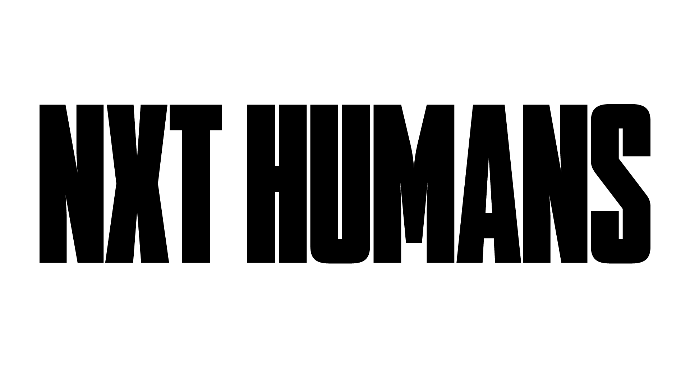

# NXT Humans AI CX Workbench - Design Onboarding Guide

## Introduction

This design guide serves as a comprehensive reference for designers working on the NXT Humans AI CX Workbench ecosystem. It outlines the global design elements, standards, and patterns to ensure consistency across all applications in the workbench:

1. **Reddit Data Collector**: Gathers Reddit data from subreddits
2. **Social Research Analysis Tool**: Advanced analytics for social media data
3. **AI Journey Mapper**: Customer journey mapping using Claude 3.7 Sonnet
4. **Launchpad**: Central dashboard for accessing all applications

By following this guide, designers will produce cohesive experiences that align with the NXT Humans brand identity while enabling each application to serve its specific purpose.

## Brand Overview

NXT Humans is a forward-thinking AI research and development company focused on human-centered AI solutions. The brand represents **innovation**, **intelligence**, and **humanity** working together to advance technology that enhances human experience.

## Design Principles

1. **Human-Centered**: Prioritize user needs and experiences in all design decisions
2. **Clear & Intuitive**: Create interfaces that are easily understood and navigated
3. **Consistent & Cohesive**: Maintain visual and interaction consistency across applications
4. **Modern & Professional**: Reflect the cutting-edge nature of AI technologies while maintaining professionalism
5. **Flexible & Scalable**: Design systems that can adapt to different content and screen sizes

## Colors

### Primary Colors

- **Cyan Primary**: `#01C4C8` (rgba(1, 196, 200, 1))
  - Used for primary buttons, key UI elements, and accents
  - CSS Variable: `--cyan-primary`
  - Variants:
    - 80% opacity: `rgba(1, 196, 200, 0.8)` / `--cyan-primary-80`
    - 60% opacity: `rgba(1, 196, 200, 0.6)` / `--cyan-primary-60`
    - 40% opacity: `rgba(1, 196, 200, 0.4)` / `--cyan-primary-40`
    - 20% opacity: `rgba(1, 196, 200, 0.2)` / `--cyan-primary-20`
    - 10% opacity: `rgba(1, 196, 200, 0.1)` / `--cyan-primary-10`
  - Hover state: `#00E5E8` / `--cyan-primary-hover`
  - Vibrant variant: `#00E5E8` / `--cyan-vibrant`

- **Dark Background**: `#121B26` / `--dark-bg`
  - Used for headers, footers, and dark UI elements
  - Creates high contrast with light text
  - Gradient variants:
    - Gradient start: `#121B26` / `--dark-bg-gradient-1`
    - Gradient end: `#1E293B` / `--dark-bg-gradient-2`

### Accent Colors

- **Accent Blue**: `#298DFF` / `--accent-blue`
- **Accent Purple**: `#9C6AFF` / `--accent-purple`
- **Success Green**: `#0CCE6B` / `--success-green`
- **Warning Yellow**: `#FFD02F` / `--warning-yellow`
- **Error Red**: `#FF5A5A` / `--error-red`

### Secondary & Text Colors

- **Light Grey**: `#5A6275` / `--light-grey`
- **Medium Grey**: `#4A5165` / `--medium-grey`
- **Dark Text**: `#333333` / `--text-dark`
- **Light Text**: `#FFFFFF` / `--text-light`
- **Grey Text**: `#666666` / `--text-grey`

## Typography

- **Primary Font**: 'Segoe UI', -apple-system, BlinkMacSystemFont, Roboto, Oxygen, Ubuntu, Cantarell, 'Open Sans', 'Helvetica Neue', sans-serif
- **Standard Font Weights**:
  - Regular: 400
  - Medium: 500
  - Semibold: 600
  - Bold: 700
  - Extra Bold: 800 (for hero titles only)

### Header Hierarchy

- **H1 (Page Titles)**: 1.8rem (28.8px), Bold
- **H2 (Section Titles)**: 1.5rem (24px), Bold
- **H3 (Card Titles)**: 1.25rem (20px), Semibold
- **H4 (Subsections)**: 1rem (16px), Semibold
- **Body Text**: 1rem/16px, Regular
- **Small Text/Caption**: 0.875rem (14px), Regular

### CSS Classes

These typography classes are available for use across all applications:

```css
h1, .h1 { font-size: 1.8rem; font-weight: 700; line-height: 1.2; }
h2, .h2 { font-size: 1.5rem; font-weight: 700; line-height: 1.2; }
h3, .h3 { font-size: 1.25rem; font-weight: 600; line-height: 1.3; }
h4, .h4 { font-size: 1rem; font-weight: 600; line-height: 1.4; }
```

## Spacing System

A consistent spacing system ensures harmony across the interface:

- **Extra Small**: 0.5rem (8px) / `--spacing-xs`
- **Small**: 0.75rem (12px) / `--spacing-sm`
- **Medium**: 1rem (16px) / `--spacing-md`
- **Large**: 1.5rem (24px) / `--spacing-lg`
- **Extra Large**: 2rem (32px) / `--spacing-xl`
- **Double Extra Large**: 3rem (48px) / `--spacing-xxl`

### Margin & Padding Utility Classes

```css
.mt-0 { margin-top: 0; }
.mt-1 { margin-top: var(--spacing-xs); }
.mt-2 { margin-top: var(--spacing-sm); }
.mt-3 { margin-top: var(--spacing-md); }
.mt-4 { margin-top: var(--spacing-lg); }
.mt-5 { margin-top: var(--spacing-xl); }

/* Similar classes for margin-bottom (mb-*), margin-left (ml-*), 
   margin-right (mr-*), and padding (p-*) */
```

## UI Elements

### Buttons

All buttons should use the `.nxt-btn` base class along with a variant class:

- **Primary Button**:
  ```html
  <button class="nxt-btn nxt-btn-primary">Button Text</button>
  ```
  - Background: Cyan Primary (`#01C4C8`)
  - Text: White (`#FFFFFF`)
  - Border: None
  - Border Radius: 4px (`var(--border-radius-sm)`)
  - Padding: 0.75rem 1.5rem
  - Hover: Darken background by 10% 

- **Secondary Button**:
  ```html
  <button class="nxt-btn nxt-btn-secondary">Button Text</button>
  ```
  - Background: Transparent
  - Text: Cyan Primary (`#01C4C8`)
  - Border: 1px solid Cyan Primary
  - Border Radius: 4px (`var(--border-radius-sm)`)
  - Padding: 0.75rem 1.5rem
  - Hover: Light Cyan background (rgba(1,196,200,0.1))

- **Size Variations**:
  - Large: `.nxt-btn-lg`
  - Small: `.nxt-btn-sm`
  - Block (full width): `.nxt-btn-block`

- **Button with Icon**:
  ```html
  <button class="nxt-btn nxt-btn-primary">
    <i class="fa-solid fa-play mr-2"></i> Launch
  </button>
  ```

### Cards

Cards are used extensively across the workbench applications for grouping related content:

```html
<div class="nxt-card">
  <h3 class="nxt-card-title">Card Title</h3>
  <div class="nxt-card-body">
    <!-- Card content -->
  </div>
</div>
```

- Background: White (`#FFFFFF`)
- Border Radius: 8px (`var(--border-radius-md)`)
- Box Shadow: 0 4px 6px rgba(0, 0, 0, 0.1) (`var(--shadow-md)`)
- Padding: 1.5rem (`var(--spacing-lg)`)
- Hover effect: Subtle lift and shadow enhancement

#### Application Cards

Application cards use a special glass morphism style with the `.app-card` class:

```html
<div class="app-card">
  <div class="app-icon">
    <i class="fa-solid fa-chart-column"></i>
  </div>
  <h3 class="app-title">Card Title</h3>
  <p class="app-description">Description text here</p>
  <div class="app-cta">
    <!-- Call-to-action button -->
  </div>
</div>
```

- Background: Glass-like effect with backdrop blur
- Border Radius: 16px 
- Top accent bar on hover
- Interactive hover effects (see enhanced components)

### Form Elements

Form elements should use the following classes:

```html
<div class="nxt-form-group">
  <label class="nxt-form-label">Label Text</label>
  <input type="text" class="nxt-form-control" placeholder="Placeholder text">
</div>
```

- Input Border Radius: 4px (`var(--border-radius-sm)`)
- Input Border: 1px solid `#DEE2E6` (`var(--border-color)`)
- Input Focus: Border color Cyan Primary, with subtle glow effect
- Form Element Spacing: 1.5rem between groups

### Status Indicators

Status indicators show the operational state of services:

```html
<div class="status-indicator status-running"></div>
<div class="status-indicator status-offline"></div>
<div class="status-indicator status-unknown"></div>
```

Status badges for more prominent display:

```html
<span class="status-badge status-running">Running</span>
```

## Global Layout Elements

### Header

The global header appears on all applications with the following structure:

```html
<header class="nxt-header">
  <div class="container">
    <div class="nxt-header-content">
      <div class="nxt-logo">
        
        <div class="nxt-logo-text">
          <h1>AI CX Workbench</h1>
        </div>
      </div>
    </div>
  </div>
</header>
```

- Background: Dark blue (`#121B26`)
- Logo: Located at `/static/nxt-humans-logo.png`
- Logo dimensions: 40px height
- Padding: 1rem 0
- Text color: White

### Footer

The global footer appears at the bottom of all applications:

```html
<footer class="nxt-footer">
  <div class="container">
    <div class="nxt-footer-content">
      <div class="nxt-footer-text">
        <p>&copy; 2025 NXT Humans. All rights reserved.</p>
      </div>
    </div>
  </div>
</footer>
```

- Background: Dark blue (`#121B26`)  
- Text color: Light grey
- Padding: 2rem 0
- Margin-top: 3rem

### Container

Use the container class for consistent content width and responsive behavior:

```html
<div class="container">
  <!-- Content goes here -->
</div>
```

- Max width: 1200px
- Centered with auto margins
- Responsive padding on smaller screens

## Responsive Design

The workbench follows these breakpoints for responsive design:

- **Mobile**: Up to 768px
- **Tablet**: 768px to 1024px  
- **Desktop**: 1024px and above

All components must be responsive. On mobile:
- Cards stack vertically
- Logo and navigation elements center-align
- Text size reduces slightly for headers
- Spacing is adjusted for smaller screens

## Animations & Interactions

The workbench uses consistent animations for a polished experience:

### Animation Variables

- Fast transition: 0.2s (`var(--animation-fast)`)
- Medium transition: 0.3s (`var(--animation-medium)`)
- Slow transition: 0.5s (`var(--animation-slow)`)

### Standard Animations

- Elements fade in on page load with the `.fade-in` class
- Cards scale subtly on hover
- Status indicators pulse when active
- Buttons have ripple effects on click

### Interactive Effects

- App cards feature a tilt effect and highlight on hover
- The workflow section responds to user interaction
- Service URLs highlight on hover

## Icons

The workbench uses Font Awesome 6.4.2 for icons:

```html
<i class="fa-solid fa-rocket"></i>
```

Common icons used across applications:
- Launch/Play: `fa-solid fa-play`
- Status/Info: `fa-solid fa-circle-info`
- Rocket (for launch all): `fa-solid fa-rocket`
- Link: `fa-solid fa-link`
- External link: `fa-solid fa-external-link-alt`
- Home: `fa-solid fa-home`
- Back: `fa-solid fa-arrow-left`
- Refresh: `fa-solid fa-sync-alt`

Application-specific icons:
- Reddit Data Collector: `fa-solid fa-magnifying-glass`
- Social Research Tool: `fa-solid fa-chart-column`
- Journey Mapper: `fa-solid fa-map`

## Shared Assets

### Logo Files

- Primary logo: `/static/nxt-humans-logo.png`
- Favicon: `/static/favicon.ico`

### CSS Files

- Base styles: `/static/nxt-humans-styles.css`
- Enhanced components: `/static/enhanced-components.css`
- Animations: `/static/enhanced-animations.js`

## Application-Specific Components

While maintaining global consistency, each application has unique components:

### Reddit Data Collector

- File upload components for Reddit data
- Progress indicators for long-running processes
- Data table displays for Reddit posts
- PDF preview components

### Social Research Tool

- Interactive data visualizations and charts
- Topic modeling displays
- Sentiment analysis results
- RAG-powered AI chat interface

### Journey Mapper

- Interactive journey map visualization
- Multi-step upload process
- Claude 3.7 integration UI
- Export option menus for journey maps

## Implementation Guidelines

For implementing this design system across applications:

1. **Always include the global CSS files** in the head of each HTML document:
   ```html
   <link rel="stylesheet" href="/static/nxt-humans-styles.css">
   <link rel="stylesheet" href="/static/enhanced-components.css">
   <link rel="icon" href="/static/favicon.ico" type="image/x-icon">
   <link rel="stylesheet" href="https://cdnjs.cloudflare.com/ajax/libs/font-awesome/6.4.2/css/all.min.css">
   ```

2. **Use the standard header and footer** across all applications with appropriate customization for the application name.

3. **Implement enhanced animations** by including the animations script:
   ```html
   <script src="/static/enhanced-animations.js"></script>
   ```

4. **Leverage CSS variables** for colors, spacing, and other design tokens to ensure consistency.

5. **Ensure responsive design** works across all screen sizes for each application.

6. **Include appropriate preloading** for key resources:
   ```html
   <link rel="preload" href="/static/nxt-humans-logo.png" as="image">
   <link rel="preload" href="https://cdnjs.cloudflare.com/ajax/libs/font-awesome/6.4.2/css/all.min.css" as="style">
   ```

## Design Review Checklist

Before finalizing designs for any application, ensure:

- [ ] All global UI elements (header, footer) match the design guide
- [ ] Color usage follows the defined palette
- [ ] Typography hierarchy is consistent
- [ ] Spacing follows the defined system
- [ ] Responsive behavior works across all screen sizes
- [ ] Animations and transitions are consistent
- [ ] Status indicators follow the established pattern
- [ ] Icons use Font Awesome with consistent styling
- [ ] Error states and loading states are designed
- [ ] Application-specific components maintain brand consistency

## Development Handoff

When handing off designs to developers:

1. Provide designs in a standard format (Figma, Sketch, or XD)
2. Include specifications for spacing, colors, and font sizes
3. Create responsive variants for mobile and tablet
4. Document any custom animations or interactions
5. Include hover, focus, and active states for interactive elements
6. Specify which global components are being used

## Examples

### Standard App Header

```html
<header class="nxt-header">
  <div class="container">
    <div class="nxt-header-content">
      <div class="nxt-logo">
        
        <div class="nxt-logo-text">
          <h1>[Application Name]</h1>
        </div>
      </div>
    </div>
  </div>
</header>
```

### Standard App Card

```html
<div class="app-card">
  <div class="status-indicator status-running"></div>
  <div class="app-icon">
    <i class="fa-solid fa-chart-column"></i>
  </div>
  <h3 class="app-title">Application Name</h3>
  <p class="app-description">Description of the application and its purpose.</p>
  <div class="app-cta">
    <a href="#" class="nxt-btn nxt-btn-primary nxt-btn-block">
      <i class="fa-solid fa-play mr-2"></i> Launch
    </a>
  </div>
</div>
```

### Form Example

```html
<form class="nxt-form">
  <div class="nxt-form-group">
    <label class="nxt-form-label">Subreddit Name</label>
    <input type="text" class="nxt-form-control" placeholder="Enter subreddit name">
  </div>
  
  <div class="nxt-form-group">
    <label class="nxt-form-label">Time Period</label>
    <select class="nxt-form-select">
      <option>Past week</option>
      <option>Past month</option>
      <option>Past year</option>
      <option>All time</option>
    </select>
  </div>
  
  <button type="submit" class="nxt-btn nxt-btn-primary">
    <i class="fa-solid fa-play mr-2"></i> Start Collection
  </button>
</form>
```

## Conclusion

By following this design guide, all applications within the NXT Humans AI CX Workbench will maintain a consistent, professional appearance while providing intuitive, user-friendly experiences. This consistency strengthens the NXT Humans brand identity and improves user experience across the entire platform.

For questions or clarifications about this design guide, please contact the design team lead.