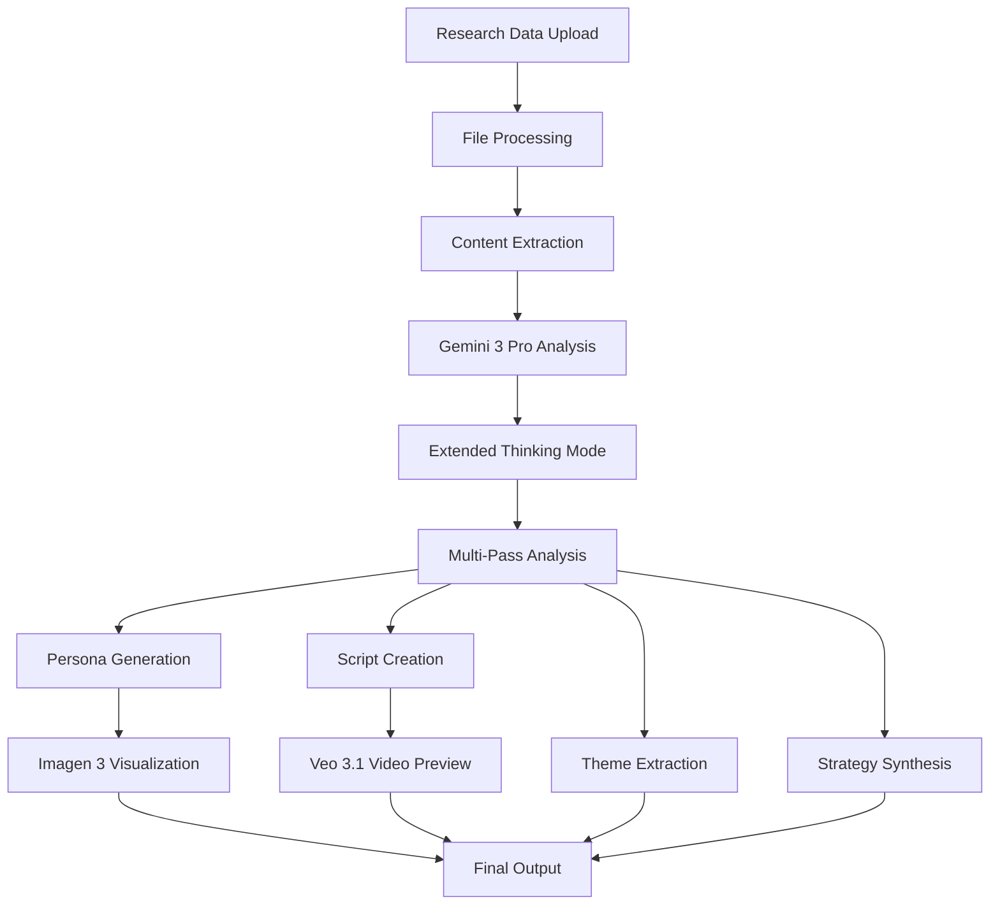

# PersonaStory AI Research Generator

## Executive Summary

PersonaStory AI Research Generator is an advanced market research analysis platform that transforms raw qualitative and quantitative research data into actionable business insights. Using Google's Gemini 3 Pro with extended thinking capabilities, the tool generates evidence-based personas, thematic analyses, video scripts, and strategic recommendations from research data in multiple formats.

## Business Value Proposition

### Key Business Benefits

- **Time Efficiency**: Reduces research analysis time from weeks to minutes
- **Evidence-Based Insights**: Every insight is backed by direct quotes and data points from source material
- **Multiple Output Formats**: Generates personas, themes, video scripts, and strategy decks from a single data upload
- **Consistency**: Ensures consistent analysis methodology across all research projects
- **Scalability**: Handles large volumes of research data without quality degradation

### Use Cases

1. **Market Research Teams**
   - Analyze focus group transcripts
   - Process survey open-ended responses
   - Synthesize ethnographic studies
   - Generate customer personas from interview data

2. **Product Development**
   - Identify unmet customer needs
   - Discover whitespace opportunities
   - Understand user pain points
   - Generate product requirement insights

3. **Marketing Strategy**
   - Create data-driven buyer personas
   - Develop campaign messaging
   - Generate video script concepts
   - Build customer journey maps

4. **Customer Experience**
   - Analyze customer feedback
   - Identify service improvement opportunities
   - Understand behavioral patterns
   - Generate CX strategy recommendations

## Features

### Core Capabilities

#### 🎭 **Persona Generation**
- Creates 3-5 detailed personas with demographics, psychographics, and behavioral traits
- Each trait backed by supporting evidence from research data
- Includes persona images generated with Google Imagen 3

#### 🎯 **Thematic Analysis**
- Identifies key themes and patterns across research data
- Provides frequency analysis and sentiment scoring
- Groups related insights hierarchically

#### 🎬 **Video Script Creation**
- Transforms research insights into compelling video narratives
- Includes scene descriptions and visual recommendations
- Optimized for 60-120 second marketing videos

#### 📊 **Strategy Deck Generation**
- Creates executive-ready PowerPoint presentations
- Includes data visualizations and key takeaways
- Structured for boardroom presentations

### Analysis Lenses

The platform offers four specialized analysis perspectives:

1. **General Ethnography**: Deep cultural and behavioral insights
2. **Whitespace Opportunity**: Identifies market gaps and innovation opportunities
3. **Behavioral Psychology**: Analyzes cognitive biases and decision-making patterns
4. **Customer Journey**: Maps touchpoints and experience optimization opportunities

## Technical Architecture

### Technology Stack

```
Frontend:
├── React 19.1.1 (UI Framework)
├── TypeScript 5.8.2 (Type Safety)
├── Vite 6.4.1 (Build Tool)
├── TailwindCSS (Styling)
└── IndexedDB (Client Storage)

Backend:
├── Flask 2.3.3 (Web Framework)
├── Python 3.9 (Runtime)
├── Gunicorn (Production Server)
└── Docker (Containerization)

AI/ML Pipeline:
├── Google Gemini 3 Pro (Analysis Engine)
├── Google Imagen 3 (Image Generation)
├── Google Veo 3.1 (Video Generation)
└── Extended Thinking (Deep Analysis)
```

### AI Model Integration Pipeline



### Detailed Technical Pipeline

#### 1. **Data Ingestion Layer**
```typescript
// Supported formats: CSV, TXT, JSON, PDF
interface FileUpload {
  name: string;
  content: string;
  type: 'csv' | 'txt' | 'json' | 'pdf';
  size: number;
}
```

#### 2. **Preprocessing Pipeline**
- Text normalization and cleaning
- Encoding detection and conversion
- Chunking for large documents (>100K tokens)
- Metadata extraction

#### 3. **Gemini 3 Pro Integration**

**Extended Thinking Implementation:**
```typescript
const generateAnalysis = async (content: string) => {
  const model = genAI.getGenerativeModel({
    model: 'gemini-3.0-pro-002',
    generationConfig: {
      temperature: 0.7,
      topK: 40,
      topP: 0.95,
      maxOutputTokens: 32768,
    },
  });

  // Enable extended thinking for deep analysis
  const thinkingPrompt = `
    <thinking>
    Analyze the research data through multiple cognitive passes:
    1. Surface-level patterns
    2. Hidden connections
    3. Psychological drivers
    4. Cultural contexts
    5. Strategic implications
    </thinking>
  `;
  
  const result = await model.generateContentStream({
    contents: [{ role: 'user', parts: [{ text: thinkingPrompt + content }] }],
  });
  
  return processStreamWithThinkingEvents(result);
};
```

#### 4. **Multi-Modal Output Generation**

**Persona Visualization (Imagen 3):**
```typescript
const generatePersonaImage = async (personaDescription: string) => {
  const imagen = genAI.getImageModel({ model: 'imagen-3.0-generate-001' });
  
  const result = await imagen.generateImages({
    prompt: personaDescription,
    numberOfImages: 1,
    aspectRatio: '16:9',
    safetyFilterLevel: 'block_only_high',
    personGeneration: 'allow_all',
  });
  
  return result.images[0];
};
```

**Video Script Preview (Veo 3.1):**
```typescript
const generateVideoPreview = async (script: string) => {
  const veo = genAI.getVideoModel({ model: 'veo-3.1-fast-generate-preview' });
  
  const operation = await veo.generateVideo({
    prompt: script,
    aspectRatio: '16:9',
    duration: 8,
    resolution: '720p',
  });
  
  // Async polling for video generation
  return pollVideoOperation(operation.name);
};
```

#### 5. **Evidence Tracking System**

Every generated insight includes traceable evidence:

```typescript
interface Evidence {
  insight: string;
  supportingQuotes: Array<{
    text: string;
    source: string;
    lineNumber: number;
    confidence: number;
  }>;
  frequency: number;
  sentiment: 'positive' | 'negative' | 'neutral';
}
```

### API Integration

The service exposes RESTful endpoints for integration:

```bash
# Health Check
GET /health

# Analysis Endpoint
POST /api/analyze
Content-Type: multipart/form-data
Body:
  - file: [research_data.csv]
  - analysisType: "GENERAL_ETHNOGRAPHY"
  - outputFormat: "FULL_ANALYSIS"

# Response
{
  "personas": [...],
  "themes": [...],
  "videoScript": {...},
  "strategyDeck": {...},
  "evidence": [...]
}
```

### MCP (Model Context Protocol) Integration

For AI agent orchestration:

```json
{
  "jsonrpc": "2.0",
  "method": "tools/call",
  "params": {
    "name": "analyze_research_data",
    "arguments": {
      "file_content": "base64_encoded_data",
      "analysis_type": "WHITESPACE_OPPORTUNITY",
      "output_format": "PERSONAS"
    }
  }
}
```

## Performance Characteristics

### Processing Metrics

| Data Size | Processing Time | Token Usage | Cost Estimate |
|-----------|----------------|-------------|---------------|
| 10 pages | ~45 seconds | ~15K tokens | $0.08 |
| 50 pages | ~2 minutes | ~75K tokens | $0.40 |
| 100 pages | ~4 minutes | ~150K tokens | $0.80 |
| 500 pages | ~10 minutes | ~750K tokens | $4.00 |

### Scalability Features

- **Streaming Response**: Real-time analysis updates
- **Chunked Processing**: Handles documents >100K tokens
- **Parallel Analysis**: Multiple analysis lenses simultaneously
- **Caching Layer**: Reduces redundant API calls

## Security & Compliance

### Data Protection

- **No Data Persistence**: Research data is processed in-memory only
- **API Key Encryption**: Secure key management via environment variables
- **HTTPS Support**: SSL/TLS encryption for all communications
- **Container Isolation**: Docker-based service isolation

### Compliance Considerations

- GDPR-ready: No PII storage
- SOC 2 compatible architecture
- Audit logging capabilities
- Data residency controls

## Installation & Deployment

### Docker Deployment

```bash
# Build the service
docker build -t research-generator .

# Run with environment variables
docker run -d \
  -p 5011:5011 \
  -e GEMINI_API_KEY=your_api_key \
  research-generator
```

### Integration with Intelligence Augmentation Suite

```yaml
# docker-compose.yml
research-generator:
  build: ./internal-solutions-research-generator
  ports:
    - "5011:5011"
  environment:
    - GEMINI_API_KEY=${GEMINI_API_KEY}
  networks:
    - nxt-humans-network
```

## API Requirements

### Google AI Platform Setup

1. **Gemini API Access**
   - Requires Gemini 3 Pro API access
   - Billing enabled on Google Cloud Project
   - API key with generative AI permissions

2. **Rate Limits**
   - 60 requests per minute
   - 1M tokens per day
   - Concurrent request limit: 10

3. **Cost Optimization**
   - Batch processing for multiple files
   - Response caching for repeated analyses
   - Token usage monitoring

## Future Enhancements

### Roadmap

- **Q1 2025**: Multi-language support (10+ languages)
- **Q2 2025**: Real-time collaboration features
- **Q3 2025**: Custom model fine-tuning
- **Q4 2025**: Automated report scheduling

### Planned Integrations

- Salesforce CRM persona sync
- HubSpot marketing automation
- Tableau visualization export
- PowerBI dashboard integration

## Support & Documentation

### Resources

- **Technical Documentation**: `/docs/technical`
- **API Reference**: `/docs/api`
- **Video Tutorials**: [YouTube Channel]
- **Support**: support@personastory.ai

### Troubleshooting

Common issues and solutions:

1. **API Key Issues**
   - Verify GEMINI_API_KEY is set in environment
   - Check API key has proper permissions
   - Ensure billing is enabled

2. **Large File Processing**
   - Files >10MB may require chunking
   - Use CSV format for optimal performance
   - Consider batch processing

3. **Output Quality**
   - Ensure research data is well-structured
   - Provide context in file headers
   - Use clear, descriptive language

## License & Attribution

- **License**: Proprietary - NXT Humans AI
- **AI Models**: Powered by Google Gemini, Imagen, and Veo
- **Framework**: Built on Intelligence Augmentation Suite

---

## Contact

**NXT Humans AI**  
Website: https://nxthumans.ai  
Email: hello@nxthumans.ai  
LinkedIn: [NXT Humans AI](https://linkedin.com/company/nxt-humans)

---

*PersonaStory AI - Turning Research into Stories That Matter*