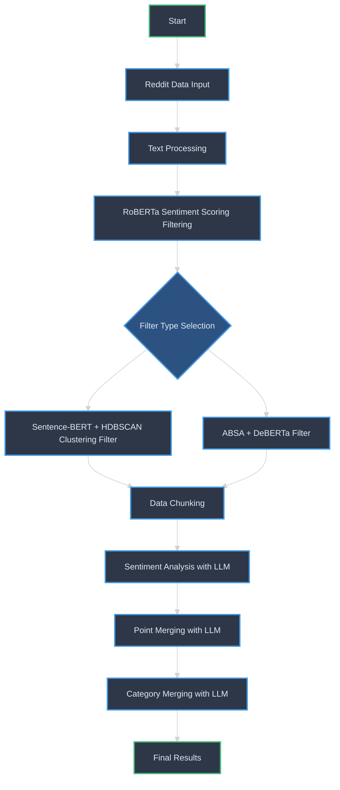

# Social Research Analysis Tool

This repository provides two  tools designed for Reddit-based social research:

## 🔍 Topic Modeling Tool

This tool helps users explore the **key themes** occurring in a subreddit, without a predefined topic.

- **Input**: Subreddit name.
- **Output**:
  - Topics with sentiment scores.
  - Interactive theme maps.
  - RAG-powered AI chat

## 🧠 Social LLM Analyzer

This tool helps users analyze sentiment around a **specific topic within a subreddit**, also provides tracable data to understand the nuances and emotional tone of discussions

- **Input**: Subreddit name and a defined topic.
- **Output**:
  - Positive and negative aspects.
  - Summary and suggestions.
  - Visualizations.


## Deployment option 1: Local Deployment with Docker

1. **Complete the Setup**
   - Follow the instructions in the repository: [NXT-Humans Dev Environment](https://github.com/NXT-Humans/nxth-dev-env)

2. **Ensure Docker Daemon is Running**
   - Open **Docker Desktop** or ensure the daemon is active via CLI:
     ```sh
     docker info
     ```

3. **Azure Login**
   - In the root directory, run:
     ```sh
     palm az-login
     ```
     > **Note** This will pop up an authorization web window for you to log in, and all credentials will be mounted inside the container ```root./.azure```. Check if this exists when there is error with Azure login
     

4. **Ensure the Docker Network Exists**
   - Create the network if it does not exist:
     ```sh
     docker network create nxt-humans
     ```

5. **Windows Users Only:**
   - Ensure `AZURE_AUTH_LOCATION` is set in `./.env`, for example:
     ```sh
     AZURE_AUTH_LOCATION=C:\Users\username\.azure
     ```

6. **Build the Docker Containers**
   ```sh
   docker compose build
   ```
   > **Note** ./docker-compose.yml will be used
   
7. Configure environment variables (ask developer for the .env file)
   
8. **Run the Containers**
   ```sh
   docker compose up
   ```

## Potential Errors and Solutions

| Error | Description | Solution |
|-------|-------------|----------|
| Error exit code 139 with seg fault | Container crashes with segmentation fault | Check memory allocation with `docker stats`. If total memory is less than 8 GB, increase memory allocation in Docker configuration. For Mac users, see [this StackOverflow thread](https://stackoverflow.com/questions/44533319/how-to-assign-more-memory-to-docker-container). |
| Azure login failure | `.azure` directory missing | Verify the `.azure` directory exists after running `palm az-login`. For Windows users, ensure the `AZURE_AUTH_LOCATION` is correctly set in your `.env` file. |
| Network connection issues | Docker network not created | Run `docker network create nxt-humans` before starting containers. |

   
## Deployment option 2: Deploy it on Azure with Github Action (WIP)
Container deployment is handled via the GitHub Actions workflow located at: ```.\.github\workflows\build-and-deploy.yml```, which will use ```\compose.deploy.yml``` instead of ```\docker-compose.yml```
### ⚙️ Local Testing with `act`

> **Note**: GitHub Actions require you to push changes to GitHub in order to test them. To streamline local testing, use the following workflow: ```.github/workflows/local-build-act.yml```
> This workflow is designed to be used with [`act`](https://github.com/nektos/act), a tool that enables local testing of GitHub Actions.
> For more details, refer to the [`act` documentation](https://github.com/nektos/act).

## Deployment option 3: Local Deployment with Python virtual environment

### Frontend Setup
1. Navigate to the frontend directory:
```bash
cd frontend
```

2. Install dependencies:
```bash
npm install
```

3. Start the development server:
```bash
npm start
```

### Backend Setup
1. Navigate to the backend directory:
```bash
cd backend
```

2. Create a virtual environment:
```bash
# First install Python 3.11 if not already installed
# On Windows: Download from https://www.python.org/downloads/release/python-3115/
# On Unix-based systems:
# For Ubuntu/Debian: sudo apt-get install python3.11
# For MacOS with Homebrew: brew install python@3.11

py -3.11 -m venv venv
source venv/bin/activate  # On Windows: venv\Scripts\activate
```

3. Install dependencies:
```bash
pip install -r requirements.txt
```

4. Configure environment variables (ask developer for the .env file)

5. For OpenAI Azure:
   1. Install Azure CLI and signin
   

   https://learn.microsoft.com/en-us/azure/ai-studio/quickstarts/get-started-code?tabs=windows

   
   2. Hit enter when prompts Select a subscription and tenant after login
      
   


## Database Setup (PostgreSQL with pgvector on macOS) (Havn't tested out)

* **Install PostgreSQL:** 
  * Install PostgreSQL version 11 or newer (version 16 recommended).
  * Using Homebrew: 
    ```bash
    brew install postgresql@16 # Or your preferred version >= 11
    brew services start postgresql@16
    ```
  * Verify installation: 
    ```bash
    psql --version
    ```

* **Install pgvector Extension:** 
  * Using Homebrew: 
    ```bash
    brew install pgvector
    ```
  * You might need to link it to your PostgreSQL installation if prompted or if the extension isn't found later. Restarting the PostgreSQL service might be needed: 
    ```bash
    brew services restart postgresql@16
    ```

* **Create Database and User (Optional but Recommended):** 
  * Use `psql` (comes with PostgreSQL) or a GUI tool like pgAdmin.
  * Connect to the default `postgres` database: 
    ```bash
    psql postgres
    ```
  * Run the following SQL commands using psql on terminal:
    ```sql
    CREATE DATABASE social_research_db; -- Replace 'your_secure_password' with a strong password
    CREATE USER social_research_user WITH PASSWORD 'your_secure_password';
    GRANT ALL PRIVILEGES ON DATABASE social_research_db TO social_research_user;
    \q
    ```

* **Enable pgvector Extension in your Database:** 
  * Connect to your newly created database: 
    ```bash
    psql social_research_db
    ```
  * Run the following SQL command:
    ```sql
    CREATE EXTENSION IF NOT EXISTS vector;
    \q
    ```


## Sentiment Analysis Pipeline
ML pipeline for sentiment analysis:



## Tech Stack

### Frontend
- React with TypeScript
- Tailwind CSS
- Real-time data streaming

### Backend
- Flask (Python)
- PRAW (Python Reddit API Wrapper)

## Setup with local virtual env 

### Prerequisites
- Python 3.11 (recommended), doesn't support 3.12
- Node.js 14+

